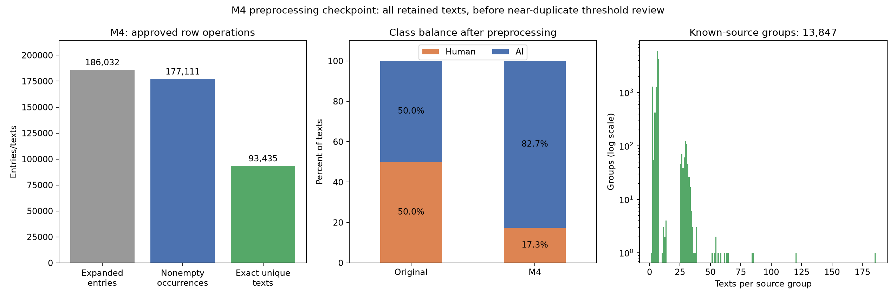
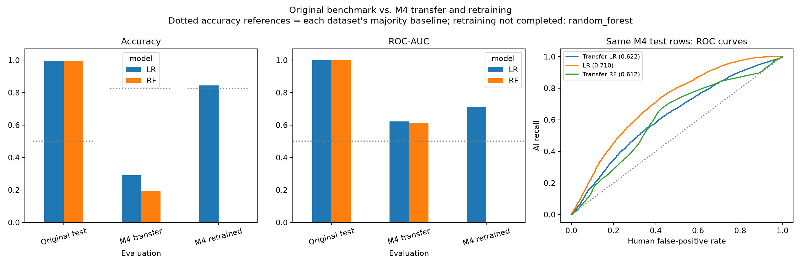
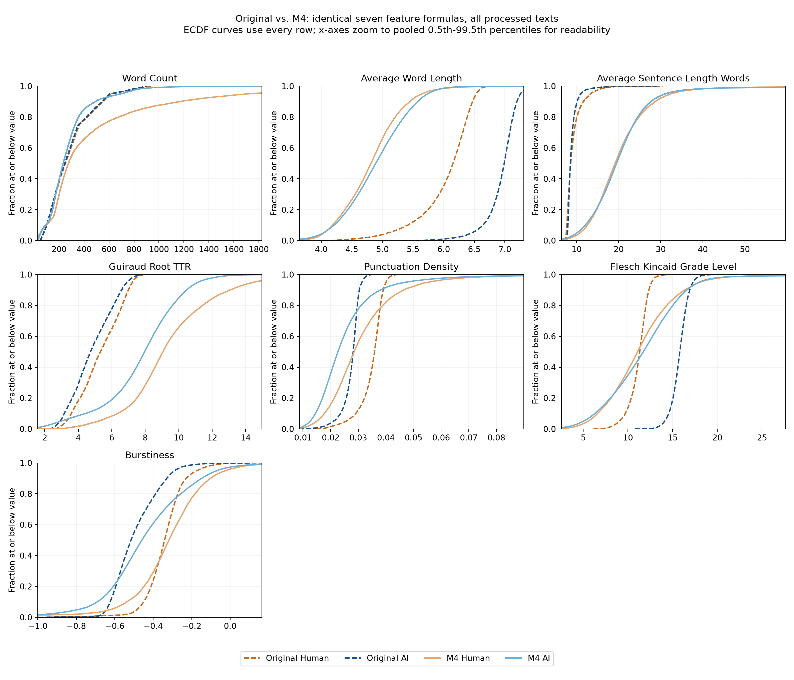

# Human vs. AI Text Classification

This CSCE 478/878 project studies Human/AI text classification using seven
independently derived text features. It records two experiments: an initial
50,000-text benchmark and an M4 extension designed to test whether the original
results generalize beyond that benchmark.

**Partner starting point: [HANDOFF.md](HANDOFF.md).** It identifies the completed
checkpoint, exact next commands, and experiments that remain open.

The [final report](final_project_report.md) contains the complete study,
decision rationale, figures, validation evidence and limitations. The
[M4 review and procedure](rubric_explanation/m4_dataset_review.md) provides its
data dictionary, schema adapters, approval history and implementation details.

## How the study developed

### 1. Audit the original benchmark before modeling

We began with Kaggle's
[`datascikhan/ai-vs-human-text-classification-benchmark-50k`](https://www.kaggle.com/datasets/datascikhan/ai-vs-human-text-classification-benchmark-50k):
50,000 texts, 30 columns and exactly 25,000 examples of each class.
The initial audit examined schema, missingness, class balance, exact duplicates,
feature distributions and source/generation metadata.

Several fields could identify how the benchmark was constructed rather than
provide evidence available from a submitted snippet. For example, generation
temperature is absent for Human rows, and source-model metadata directly
distinguishes source classes. The benchmark detector score was excluded from
predictors. Formal-tone scores also had an unexplained class-associated ceiling.
These observations motivated a text-only input policy and explicit owner review.

### 2. Derive and review our own features

The original dataset did not disclose reproducible formulas for its engineered
columns, so we implemented documented calculations directly from `Raw_Text`.
We reviewed correlations and redundancy, then retained seven representatives:

| Feature | Signal family |
| --- | --- |
| Word count | Text length |
| Average word length | Word-level style |
| Average sentence length | Sentence structure |
| Guiraud root TTR | Lexical diversity |
| Punctuation density | Punctuation relative to character count |
| Flesch-Kincaid grade | Readability using the documented syllable heuristic |
| Burstiness | Variation in sentence lengths |

`src/text_features.py` implements these formulas. Raw text and identifiers remain
available for traceability but do not enter the numeric feature matrix. Metadata,
an existing detector's scores and the target never become predictors.

### 3. Control related texts and evaluate the first models

The original near-duplicate audit revealed 11 class-specific writing-template
families. We created reproducible group-aware 40,000/10,000 train/test partitions
and five training CV folds, then tuned LR and RF using validation ROC-AUC.
We also held out entire template families as a separate stress test.

Original test accuracy reached 99.44% for LR and 99.52% for RF. The models relied
on similar style signals, and the small test advantage of RF was not significant
under the original comparison. The template structure limited what these scores
could establish about independently collected writing. We retained this whole
experiment as evidence motivating the next question, not as a discarded result.

### 4. Introduce M4 to test transfer and retraining

We selected the [M4 Kaggle mirror](https://www.kaggle.com/datasets/serjhenrique/m4-multi-generator-domain),
version 1, because it links to an [original research project](https://github.com/mbzuai-nlp/M4)
and supports multiple domains and generators. Its 28 files cover arXiv, peer
reviews, Reddit, wikiHow and Wikipedia. We audited its actual records instead
of assuming a uniform schema or treating the mirror's size as proof of quality.

The owner approved one passage/review per observation, empty-entry exclusion,
exact deduplication with provenance, the same seven features, no length cuts or
downsampling, and grouping of related source texts. The transformation counts are:

| Operation | Before | After |
| --- | ---: | ---: |
| Expand paired/list-valued records | 68,548 records | 186,032 entries |
| Exclude empty entries/placeholders | 186,032 entries | 177,111 nonempty occurrences |
| Consolidate exact duplicates | 177,111 occurrences | 93,435 unique texts |
| Extract unchanged seven features | 93,435 texts | 93,435 processed rows |

All retained origins remain in a separate provenance table. Missing source IDs
do not automatically exclude text. Schema-specific response fields avoid blindly
using prompt-bearing fields; reviews are expanded individually, not concatenated.
Raw files are immutable and downloads/builds have checksum manifests.

The complete corpus has 16,148 Human and 77,287 AI texts. We did not rebalance it
by deleting examples. An exhaustive word-trigram similarity audit and pair review
led to an owner-approved **0.85** additional grouping threshold. Combined source
and similarity grouping produces **13,799 groups**, largest **216 texts**.
The validated split has **74,757 training** and **18,678 test texts**, with five
group-aware training CV folds. Known related groups never cross those boundaries.



### 5. Separate the transfer question from the retraining question

We first applied the original models to the same M4 test set without fitting
them on M4. Original binaries were absent locally, so both models were explicitly
reconstructed from saved parameters and original training membership. Both
reproduced all 10,000 saved original test classifications; probability differences
and versions are documented. These are reconstructions, not recovered historical
binary files.

We then tuned a new LR on M4 training folds using the same seven features.
The M4 RF search was stopped at the owner's request and is deferred to the partner.
There is no completed M4-retrained RF result or resumable partial search.

| Evaluation | Accuracy | AI recall | ROC-AUC | Balanced accuracy | Human false-positive rate |
| --- | ---: | ---: | ---: | ---: | ---: |
| Original LR on original test | 99.44% | 99.56% | 0.9998 | 99.44% | 0.68% |
| Original RF on original test | 99.52% | 99.78% | 0.9999 | 99.52% | 0.74% |
| Original LR transferred to M4 | 29.08% | 16.05% | 0.6221 | 53.74% | 8.58% |
| Original RF transferred to M4 | 19.42% | 3.23% | 0.6119 | 50.04% | 3.16% |
| LR retrained on M4 | 84.36% | 99.25% | 0.7103 | 56.20% | 86.84% |

Original test scores use a different test corpus. Transfer and retraining use
the same 18,678 M4 test texts. All models retain a 0.5 classification threshold;
hyperparameters are selected by training CV, not these test scores.

**Interpretation:** near-perfect original scores do not transfer. Retraining
improves M4 ranking, but its default-threshold decisions remain poor for Human
texts. Always predicting AI already obtains **82.71% M4 test accuracy**, so LR's
84.36% accuracy and 0.913 AI F1 must not be interpreted without its 86.84% Human
false-positive rate. Its validation ROC-AUC is 0.7129 and test ROC-AUC is 0.7103;
a small train/validation gap does not establish that the model is adequate.



The comparison has no M4-retrained RF bar because that search was deferred.
Paired whole-group bootstrap intervals and domain errors are saved alongside
the measured results; their interpretation is in the final report.



The distribution figure uses all processed texts; axis percentile zoom is for
display only. The much smaller Human/AI word-length and readability differences
in M4 help explain the need for transfer testing. They are not a substitute for
model evaluation.

## Next experiments and study limitations

The current LR is an unweighted baseline with fixed threshold 0.5. Recommended
follow-up experiments, in priority order, are:

1. Run the deferred RF on the existing data/folds to obtain a nonlinear comparison.
2. Compare unweighted and `class_weight="balanced"` LR using training CV. With
   approximately 83% AI data, accuracy and positive-class F1 can hide Human errors.
3. Use training out-of-fold probabilities to select a decision threshold for an
   explicitly chosen Human false-positive/AI-recall tradeoff. Threshold changes
   do not by themselves improve ROC-AUC.
4. Inspect the saved regularization grid and domain errors; add text-length slices
   before expanding the search. The selected LR has `C=1000`, L1, but its mean CV
   AUC differs from `C=10` by only about 0.000004, much less than fold variation.
   A wider C search alone is unlikely to fix the observed Human false positives.
5. Consider domain/generator holdouts and separately reviewed feature or text-
   vectorization comparisons if the seven-feature representation is too limited.

These are proposals, not completed improvements or guarantees. The current test
results have been examined. Follow-up design must be documented; tune on training
folds and use fresh independent evaluation for strong confirmatory claims rather
than repeatedly selecting changes from this test set. Feature changes, extra row
exclusions and changes to the approved split policy require owner review.

M4 also has limitations: inconsistent source/model metadata, prompt-like copied
content, degenerate number sequences and entity-swapped templates in some
generations, older generators, and an Unknown license entry on the Kaggle mirror.
The approved pipeline retains those texts and documents the risks. Grouping
limits shared-content contamination but does not repair data or establish
semantic independence. No universal authorship-detection claim is made.

## Reproduce the M4 experiment

The M4 extension uses separate artifact paths and preserves the original
workflow below. Set up the environment first; commands here use Windows
PowerShell from the repository root.

For a fresh checkout, create the recorded environment first:

```powershell
py -3.12 -m venv .venv
.\.venv\Scripts\python.exe -m pip install -r requirements-m4-lock.txt
```

From the repository root, use the existing environment:

```powershell
.\.venv\Scripts\python.exe src/download_m4.py
.\.venv\Scripts\python.exe src/audit_m4.py
```

`requirements-m4-lock.txt` records the executed Windows/Python 3.12 environment
for a partner reproducing the M4 scripts. Install it in a fresh environment with
`python -m pip install -r requirements-m4-lock.txt`. It does not include notebook
tooling; the general `requirements.txt` continues to cover the original workflow.

The downloader pins Kaggle `serjhenrique/m4-multi-generator-domain` to version 1,
extracts into `data/raw/m4/v1/`, and records SHA256 checksums. Existing raw files
are verified rather than overwritten. Public downloading worked without login
in this checkout. If Kaggle requires authentication on another computer,
download version 1 from the dataset page and use:

```powershell
.\.venv\Scripts\python.exe src/download_m4.py --archive "C:\path\to\m4.zip"
```

The audit writes reports and PNG plots under `reports/m4/`, plus an exploratory
inventory and a deterministic feature sample under `data/processed/m4/`.
The sample contains at most 500 nonempty entries per domain/class and reuses
the seven approved feature formulas. It retains repeated passages and is
**not a final model matrix, representative probability sample, or evaluation set**.
It does not assign splits or train models. It is retained as an earlier audit
checkpoint, separate from the approved full-corpus outputs. To verify parsing:

```powershell
.\.venv\Scripts\python.exe -m unittest discover -s tests -p test_m4_audit.py
```

The owner subsequently approved the full nonempty exact-unique corpus, the same
seven features, provenance preservation, and group-aware 80/20 plus five-fold CV.
Build the approved feature CSV and inspect near-duplicate diagnostics with:

```powershell
.\.venv\Scripts\python.exe src/prepare_m4.py
.\.venv\Scripts\python.exe src/validate_m4.py
.\.venv\Scripts\python.exe src/plot_m4_comparison.py
.\.venv\Scripts\python.exe src/audit_m4_similarity.py
.\.venv\Scripts\python.exe -m unittest discover -s tests
```

The owner approved 0.85 after the diagnostic review. Create the partitions and
train with:

```powershell
.\.venv\Scripts\python.exe src/build_m4_splits.py --threshold 0.85
.\.venv\Scripts\python.exe src/train_m4.py --model logistic_regression --jobs 2
```

The partner's deferred RF command is:

```powershell
.\.venv\Scripts\python.exe src/train_m4.py --model random_forest --jobs 4
```

Each writes models to `models/m4/` and reports to `reports/m4/`. RF requires a
fresh full search; the canceled run has no checkpoint. Both models use the same
stored folds and original parameter grids. Test rows are excluded from tuning.
Worker count changes computation scheduling, not the approved inputs/folds.

`src/evaluate_m4_transfer.py` evaluates original models without fitting them on
M4. Original binaries are not stored in Git. When absent, use the explicit
`--reconstruct-original` option to rebuild from saved original parameters and
test membership, with prediction-agreement checks recorded separately.
`--reconstruct-original --reconstruct-only` prepares those models without
requiring M4 partitions or evaluating M4. These are reconstructions, not claims
that the historical binary models were recovered.

Prepare the original feature CSV using the original preprocessing commands
below before reconstruction. Then run transfer and the results summary:

```powershell
.\.venv\Scripts\python.exe src/evaluate_m4_transfer.py --reconstruct-original
.\.venv\Scripts\python.exe src/summarize_m4_results.py --bootstrap 200
```

The summary supports the completed LR and both transfer models even while RF
retraining is deferred. It checks identical held-out IDs/labels/groups, reports
paired bootstrap intervals by whole test groups, writes domain error summaries,
and creates `reports/m4/study_model_comparison.png`. After RF finishes, rerun the
summary to include it. Bootstrap intervals condition on these fixed models and
do not include uncertainty from retraining or choosing another split.

The first exhaustive M4 similarity pass took approximately 33 minutes for pair
comparisons, plus vector construction. Its checksum-matched cache avoids repeating
the pair pass when reviewing thresholds. The executed LR tuning/evaluation took
about 7.8 minutes with two workers; original-benchmark runtimes below do not
predict M4 runtimes. Both searches use the CPU; a GPU or paid API is unnecessary.

`data/` and `models/` are ignored by Git. A new clone has reports/code, but each
partner must reproduce the local data/models or arrange an appropriate local
artifact transfer. [HANDOFF.md](HANDOFF.md) distinguishes these cases.

## Reproduce the original benchmark

The following commands preserve the first experiment's workflow, notebooks,
feature review, plots and results.

## Requirements

- Python 3.12 (used for the recorded M4 environment)
- Internet access for the Kaggle download

## Set up a virtual environment

Run these commands from the repository root.

### Windows PowerShell

```powershell
py -3.12 -m venv .venv
.\.venv\Scripts\Activate.ps1
python -m pip install --upgrade pip
pip install -r requirements.txt
```

### macOS or Linux

```bash
python3.12 -m venv .venv
source .venv/bin/activate
python -m pip install --upgrade pip
pip install -r requirements.txt
```

## Download and prepare the dataset

The `data/` directory is intentionally ignored by Git. A fresh clone will not
contain the raw or derived CSVs, so each collaborator must download and build
them locally. With the virtual environment activated, run:

```bash
python src/prepare_data.py
```

This downloads [`datascikhan/ai-vs-human-text-classification-benchmark-50k`](https://www.kaggle.com/datasets/datascikhan/ai-vs-human-text-classification-benchmark-50k) into `data/raw/`, validates the required fields, and writes a conservative prepared copy to `data/processed/AI_vs_Human_Text_Classification_Benchmark_processed.csv`. The analysis was developed against the local Kaggle version 1 download. If Kaggle serves a newer version, compare the schema and row counts before treating results as identical. The original CSV is never edited. Preparation preserves all rows, raw text, and missing metadata values; it converts `Label` to an integer and adds a readable `Label_Name` column.

Expected local files after this step:

- `data/raw/AI_vs_Human_Text_Classification_Benchmark.csv`
- `data/processed/AI_vs_Human_Text_Classification_Benchmark_processed.csv`

Most public datasets can be downloaded without authentication. If Kaggle requests authentication or dataset consent, sign in to Kaggle and configure a token using the [KaggleHub authentication guide](https://github.com/Kaggle/kagglehub#authenticate). You can also run `python -c "import kagglehub; kagglehub.login()"` to enter a token interactively. Keep tokens out of the repository.

## Explore the data

After downloading and preparing the dataset, print a summary of the raw CSV, including its dimensions, first rows, data types, class balance, missing values, numeric statistics, duplicate checks, constant columns, and source-model counts:

```bash
python src/explore_data.py
```

Create visualizations under `reports/figures/`:

```bash
python src/visualize_data.py
```

These commands operate on the downloaded raw CSV and do not train models.

Create an independently reproducible, text-only candidate feature artifact and
its review plots:

```powershell
python src/build_candidate_features.py
python src/visualize_candidate_features.py
```

The candidate extractor in `src/text_features.py` does not trust the source
CSV's undocumented engineered feature formulas. It derives auditable features
directly from `Raw_Text`; the resulting CSV and figures are intermediate review
artifacts for comparison with the reduced policy. The full 50,000-row extraction
prints progress in 1,000-row chunks and may take several minutes on a typical
laptop. Extracting features from one new passage is fast.

Expected candidate output:

- `data/processed/text_derived_features_candidate.csv`
- `reports/figures/candidate_text_feature_correlation_matrix.png`
- `reports/figures/candidate_text_feature_distributions.png`

## Write the reduced preprocessing artifact

After the candidate artifact has been created, write the reduced preprocessing
artifact:

```powershell
python src/prepare_final_data.py
```

This writes `data/processed/human_ai_text_processed.csv`. It retains
`Text_ID`, `Raw_Text`, and `Label` for traceability and includes seven reduced,
independently derived model features.

The reduced CSV is the preprocessing handoff for modeling. It is not a model
prediction file. Near-duplicate grouping and the group-aware train/test split
are performed by `src/build_splits.py`, not by this CSV-writing script.

## Build near-duplicate groups and the train/test split

```bash
python src/build_splits.py
```

This takes about two minutes. It scores every pair of texts by word-trigram
overlap, groups near-duplicates (similarity >= 0.82) and template families
(similarity >= 0.60), and writes a reproducible, stratified, group-aware
80/20 train/test split plus five CV folds to
`data/processed/human_ai_text_splits.csv`. Diagnostics go to
`reports/metrics/split_summary.json` and
`reports/figures/near_duplicate_similarity_diagnostics.png`. The feature CSV
is not modified. See
`rubric_explanation/data_preprocessing_and_exploration.md` for how the
thresholds were derived and for the finding that the benchmark is built from 11
single-class writing templates.

## Train and evaluate models

```bash
python src/train_logistic_regression.py
python src/train_random_forest.py
python src/compare_models.py
```

Each training script tunes its model with the same group-aware CV folds,
scores the held-out test set once, runs the template-family hold-out stress
test, and writes metrics and test predictions to `reports/metrics/`, figures to
`reports/figures/<model>_*.png`, and the fitted model to `models/<model>.joblib`
(ignored by Git). Logistic regression takes about 10 seconds. The random
forest takes about 3 minutes. `compare_models.py` reads the saved results
(no retraining) and writes a side-by-side table, a McNemar test, and comparison
figures. Results are summarized in
`rubric_explanation/model_eval_and_comparison.md`. New models should reuse the
shared loaders, folds, and metrics in `src/modeling.py` so comparisons stay
fair.

## Notebooks

The `notebooks/` folder walks through rubric steps 1–4 in order:

| Notebook | Rubric section |
| --- | --- |
| `01_problem_and_data_understanding.ipynb` | Problem definition and data understanding |
| `02_preprocessing_and_features.ipynb` | Preprocessing, features, near-duplicates, split |
| `03_logistic_regression.ipynb` | Model 1 |
| `04_random_forest.ipynb` | Model 2 |
| `05_model_comparison.ipynb` | Evaluation, comparison, error analysis, recommendation |

They are committed with outputs, so they can be read on GitHub without
running anything. They call the scripts in `src/`, so a notebook and its script
always produce the same numbers. To run them, finish the data steps above and
then open the folder in Jupyter or VS Code using the `.venv` kernel, or run
everything headless:

```bash
jupyter nbconvert --to notebook --execute --inplace notebooks/*.ipynb
```

## Classify a new text snippet

After training, score any text:

```bash
python src/predict_text.py "Paste a passage of text here."
```

```bash
python src/predict_text.py --model random_forest "Paste a passage of text here."
```

It prints the predicted class, the probability that the text is AI-generated,
and the seven feature values it used. `--file path.txt` and standard input also
work.

The original visualization script writes class-balance, word-count, detector-score,
and source-model plots, plus scatter plots for word count vs. lexical diversity,
sentence length vs. readability, formal tone vs. emotion intensity, formal tone
vs. burstiness, coherence vs. burstiness, and emotion intensity vs. burstiness.
Scatter plots use an equal sample of up to 5,000 rows per class to reduce
overplotting. It also writes a chart showing how often the formal-tone score
reaches 100 and an AI-only histogram comparing score-bin counts against an
equal-count reference. These are exploratory views; no model training is part
of this stage.

## Dataset notes and project layout

In this dataset, `Label` 0 means Human and `Label` 1 means AI. Labels are balanced at 25,000 examples per class. Some metadata strongly identifies the source group: `Source_Model` is `Human_Origin` for every human sample and names the generating model for AI samples. `Model_Temperature` is missing for human rows, and `Contains_Code_Snippet` is constant. Keep these patterns in mind when interpreting the exploratory plots.

### Important observation: formal tone score

- `src/data_loader.py` downloads the dataset and loads the raw CSV.
- `src/explore_data.py` prints an exploratory summary.
- `src/visualize_data.py` writes charts to `reports/figures/`.
- `src/preprocessing.py` validates required fields and adds a readable label name while preserving the raw data and structural missing values.
- `src/prepare_data.py` creates the processed CSV under `data/processed/`.
- `src/text_features.py` independently derives auditable text-only features.
- `src/build_candidate_features.py` writes the full independently derived feature artifact.
- `src/visualize_candidate_features.py` creates candidate-feature review plots.
- `src/prepare_final_data.py` writes and validates the reduced seven-feature CSV.
- `src/build_splits.py` builds near-duplicate groups, template families, and the group-aware train/test and CV split.
- `src/modeling.py` holds the shared data loading, folds, metrics, and plots used by every model.
- `src/train_logistic_regression.py` tunes and evaluates the logistic-regression baseline.
- `src/train_random_forest.py` tunes and evaluates the random-forest model.
- `src/compare_models.py` compares all trained models on the same test rows.
- `notebooks/` holds the step-by-step rubric notebooks (01–05).
- `src/predict_text.py` classifies an arbitrary text snippet with a trained model.
- `data/raw/` holds the original Kaggle file; `data/processed/` is for derived data. Git ignores all of `data/`.
