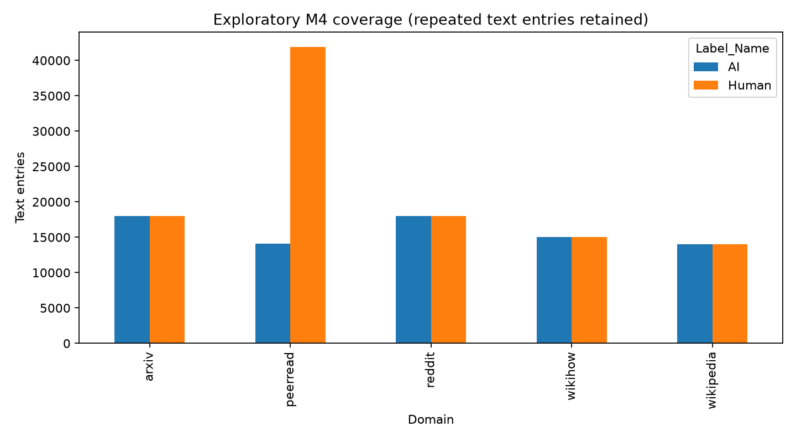
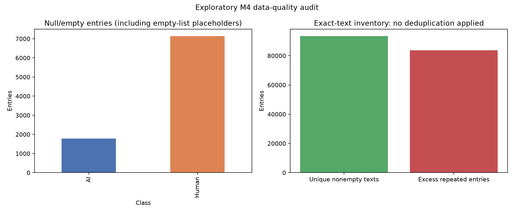
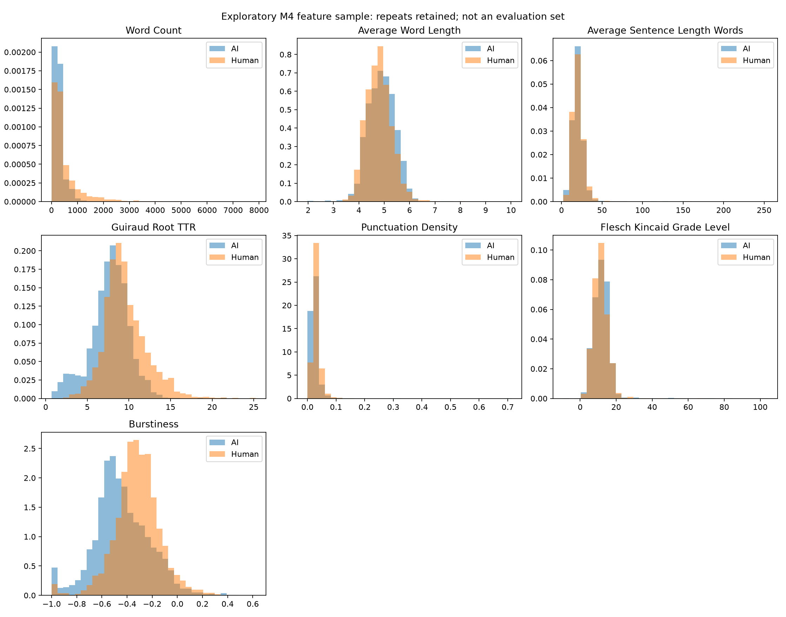
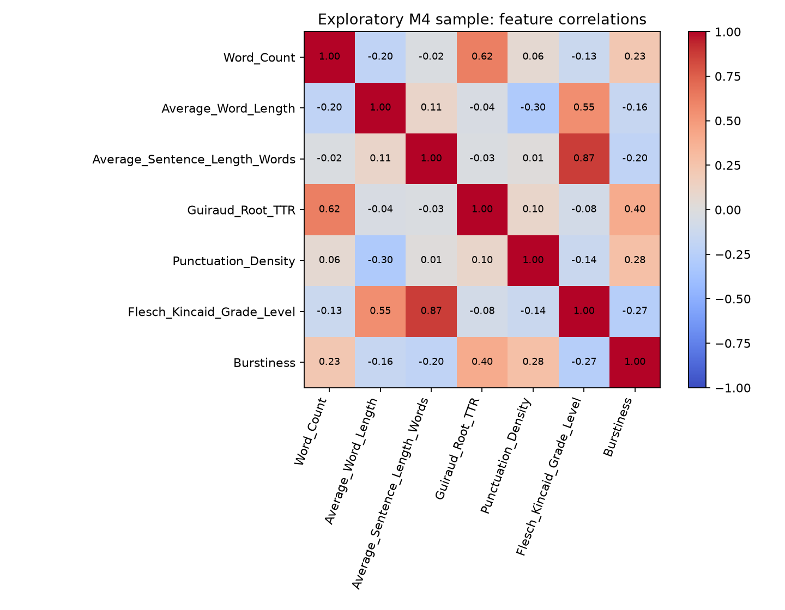

# M4 second-dataset review and partner handoff

Status: owner approved one passage/review per observation, empty-entry exclusion, exact deduplication with provenance, and keeping related sources together. The owner additionally approved all nonempty exact-unique texts without length cuts/downsampling, the same seven features, metadata excluded from predictors, an approximately 80/20 group-aware split and five group-aware CV folds, training-only scaling, and `m4_processed.csv`, `m4_provenance.csv`, `m4_splits.csv` under `data/processed/m4/`. After reviewing diagnostics, the owner approved a 0.85 word-trigram cosine threshold for additional near-duplicate grouping. Original benchmark data, models, reports, and feature schema remain intact.

## Why extend the study

The original 50,000-row benchmark produced 99.44% logistic-regression accuracy and 99.52% random-forest accuracy. The existing audit documents 11 class-specific template families. These are useful findings about that benchmark, but do not establish generalization to independently sourced human and machine writing. The second experiment asks whether the same seven independently derived text features transfer to a more varied corpus, and whether retraining helps.

The final report should retain the first experiment, its figures and results, the evidence motivating a second dataset, this dataset-selection rationale, the second experiment, and a discussion of differences. A decrease in scores can be useful evidence; dataset selection is not based on obtaining a preferred accuracy.

## Source and reproducibility

- Kaggle mirror: https://www.kaggle.com/datasets/serjhenrique/m4-multi-generator-domain
- Pinned release: Kaggle version 1 (uploaded January 10, 2024).
- Original project: https://github.com/mbzuai-nlp/M4
- Paper: https://aclanthology.org/2024.eacl-long.83/
- Original schema notes: https://github.com/mbzuai-nlp/M4/blob/main/data/README.md
- Raw location: `data/raw/m4/v1/` (ignored by Git).
- Checksum manifest: `data/raw/m4/v1/download_manifest.json`.

The public Kaggle archive downloads without credentials in this checkout. `src/download_m4.py` also accepts a manually downloaded archive with `--archive`. The supplied archive must be version 1; a manual archive's authenticity/version must be checked against Kaggle, since a checksum alone does not prove origin. The mirror's license metadata is Unknown; resolve usage terms from the original sources before redistributing records. The mirror is an older snapshot, not a claim of coverage of current generators.

## Exploratory data dictionary

`src/audit_m4.py` inventories the five filename domains arxiv, peerread, reddit, wikihow, and wikipedia. Filename-based scope is not a per-document language verification. All metadata below is audit/traceability information, not model input.

| Field | Exploratory role |
| --- | --- |
| `Text_ID` | SHA256 of file, physical line, original text field, list-entry path |
| `Raw_Text` | Unmodified selected text; null is preserved |
| `Label`, `Label_Name` | Approved 0=Human, 1=AI, inferred from original field role |
| `Domain`, `Generator`, `Source`, `Source_ID` | Provenance; generator is the record's metadata, which may be inconsistent |
| `Raw_File`, `Raw_Line`, `Entry_Index`, `Text_Field` | Trace back to original entry and selected field |
| `Source_Group_Candidate` | Candidate ID from domain, source ID, and PeerRead venue scope; not a validated final group |
| `Exact_Text_SHA256` | Original nonempty text hash for duplicate inventory |
| `Normalized_Text_SHA256` | Whitespace-normalized, case-folded text hash, for audit only |
| `Missing_Or_Empty` | Flags null, empty, or whitespace-only text |
| `Audit_Word_Count` | Existing tokenizer's count, used only for diagnostics |
| `AI_Disclaimer_Flag` | Exploratory phrase flag; not proof of invalid text |
| `Raw_Machine_Text_Starts_With_Prompt` | Raw record's string machine_text starts with its nonempty prompt |
| Seven `Text_*` feature columns | Same formulas/list as `src/prepare_final_data.py`, approved for M4 comparison |

## Transformation log and adapters

No raw data is modified. JSONL blank lines are counted separately and do not represent observations. Unexpected JSON or text types fail visibly.

1. Inventory all English-domain files, counts, checksums, and field shapes.
2. Expand each human/machine string into an exploratory entry. List-valued peer reviews are expanded independently, without asserting one-to-one pairing. Empty lists and null text remain flagged entries.
3. For BLOOMZ files, select these explicit candidate response fields instead of blindly using the prompt-bearing `machine_text` field:

| Domain | Human field | Machine field |
| --- | --- | --- |
| arxiv | abstract | machine_abstract |
| peerread | human_reviews | bloom_reviews |
| reddit | text | machine_answer |
| wikihow | text | machine_abstract |
| wikipedia | text | machine_abstract |

   Other files use `human_text` and `machine_text`. The selected field is saved. These explicit response-field adapters are used by the approved preprocessing implementation; alternate raw fields remain untouched for auditability.
4. Accept source-ID aliases `source_ID`, `source_id`, `question_id`, `q_id`, `id` in that order. Normalize integral float IDs to integer strings for candidate grouping. Non-PeerRead source labels are inconsistent, so candidate scope uses filename domain; PeerRead also retains venue scope. Missing IDs are flagged, not silently replaced by unique row IDs. These groups need further validation.
5. Report full-entry exact/normalized duplicates and conflicting-label groups; do not remove them. Human text can repeat across model files.
6. Select up to 500 nonempty entries per domain/class by deterministic SHA256 ordering with seed prefix 478, retaining duplicates. This is an exploratory sample only. No length filtering or outlier removal is applied.
7. Compute the existing seven features on this sample, reporting missing counts. Preserve punctuation/case in text used for feature extraction. No imputation, encoding, scaling, learned feature selection, or model fitting occurs.

`reports/m4/audit_summary.json` records before/after counts for each row-level operation, coverage, duplicates, and raw per-file schemas/checksums. `reports/m4/coverage.csv` records domain/class/generator entry counts.

## Proposed feature-risk and treatment review

### Observed version-1 audit results

The executed audit of all 28 JSONL files found:

| Quantity | Count |
| --- | ---: |
| Parsed source records | 68,548 |
| Blank JSONL lines (not records) | 8 |
| Expanded entries (including null/empty-list placeholders) | 186,032 |
| Human entries before any deduplication | 106,939 |
| AI entries before any deduplication | 79,093 |
| Null/empty entries | 8,921 |
| Nonempty entries | 177,111 |
| Unique exact nonempty texts | 93,435 |
| Unique exact nonempty Human texts | 16,148 |
| Unique exact nonempty AI texts | 77,287 |
| Excess exact repeated entries | 83,676 |
| Unique normalized nonempty texts | 93,228 |
| Exact or normalized text groups with conflicting labels | 0 |
| Entries without an available source-ID alias | 30,000 |
| Candidate source groups (not validated final groups) | 15,586 |
| Exploratory feature sample | 5,000 |

All seven features are complete in the exploratory sample. Human/AI histograms overlap substantially; this is an exploratory visual observation, not a model performance claim. Counts above describe the adapters' expanded entries, not 186,032 independent examples. In particular, repeated human entries and multiple reviews of one paper must not be interpreted as independent source documents.

The raw-record prefix diagnostic flags 229 records, but it detects only an exact string prefix: it is not an exhaustive prompt-contamination check. Generator metadata needs verification: for example, the first `peerread_llama.jsonl` record reports `model=flan-t5`, and the first `reddit_dolly.jsonl` record reports `source=arxiv`. The audit preserves these values without silently correcting them.

The download command was run again successfully to verify existing raw files against the archive and checksum manifest without overwriting them. Four parser tests passed for list expansion, source identity, BLOOMZ response selection, null handling, and rejecting unknown schemas. This paragraph describes the initial audit checkpoint; the subsequent owner approvals are recorded at the top of this document and in AGENTS.md.

| Candidate issue | Risk | Initial proposal / remaining risk (approved decisions below supersede this review) |
| --- | --- | --- |
| Same human passage repeated for several generators | Inflated sample size; content crosses splits | Keep one canonical human observation with provenance links; group all related generations |
| Prompt-bearing fields and prompt remnants | Class shortcut unrelated to authorship | Use reviewed response fields; audit other remnants and count any exclusions |
| Lists of reviews | Joining changes prediction unit; paper leakage | One review per observation, same paper group |
| Inconsistent/missing source and generator metadata | Incorrect holdouts or grouping | Reconcile against text hashes and prompts; preserve raw metadata and flags |
| Exact/normalized label conflicts | Ambiguous labels | Review conflict groups; propose quarantine with counts |
| Very short/long texts | Length/domain shortcuts; unreliable style summaries | Plot lengths; review limits, avoid automatic outlier deletion |
| Readability and sentence splitting | Heuristic syllables; abbreviations affect boundaries | Keep original formulas for first comparison; report limitations |
| Single-sentence burstiness | Same value for every one-sentence text | Report proportion; assess sensitivity without silently changing formula |
| Genre and generator confounding | Apparent detection is source classification | Balance/report domain coverage; add separate domain/generator holdouts |

## Approved processing and completed evaluation checkpoint

The owner approved one passage/review per row, the same seven features, text-only predictors, exclusion of empty entries, exact deduplication with provenance, no length cuts/downsampling, and related-source grouping. The final processed schema is the original four traceability/target columns plus the unchanged seven feature columns. No imputation is approved or implemented; processing fails if any feature is nonfinite rather than silently deleting more texts.

Approved final paths: `data/processed/m4/m4_processed.csv`, `data/processed/m4/m4_provenance.csv`, and `data/processed/m4/m4_splits.csv`. New models use `models/m4/`; evaluation outputs use `reports/m4/`. The owner approved approximately 80/20 stratified group-aware train/test and five group-aware CV folds, with scaling fitted only inside training folds.

The full 93,435-row CSV and 177,111-row provenance table have been generated. `src/validate_m4.py` passed checksum, schema/count, content-ID, binary target, finite-feature, provenance coverage, source-relation, and scalar/vectorized feature-recomputation checks on 100 deterministic rows. Results are recorded in `reports/m4/validation_summary.json`. Nine focused parsing/grouping/split tests pass, plus an end-to-end training test that verifies training-only scaling. `requirements-m4-lock.txt` snapshots the executed Windows/Python 3.12 environment. `src/plot_m4_comparison.py` generates the final report's preprocessing checkpoint and full-corpus original-vs-M4 distribution figures; percentile axis zoom affects display only and does not remove rows.

`src/prepare_m4.py` links all texts from each raw source record, all available candidate source IDs, and normalized-equivalent texts. Duplicate texts retain all origins, so they bridge related sources rather than losing relationships. This gives 13,847 source groups, with 185 texts in the largest group, before near-duplicate edges are considered. The grouping was reproduced after reordering provenance. These controls are conservative; they do not prove all semantic relationships have been discovered.

`src/audit_m4_similarity.py` evaluates exact binary word-trigram cosine across the full canonical corpus in sparse blocks. After normalization, trigrams that occur in only one text can be removed without changing cross-text dot products. It caches edges at similarity >=0.70 and writes label-blind review pairs and a threshold-versus-group-size diagnostic. The owner approved 0.85, and `src/build_m4_splits.py --threshold 0.85` generated the validated partitions. The old benchmark's 0.82 threshold was not automatically reused. Original-dataset overlap checks cover normalized exact text, not semantic independence.

The completed all-pairs audit is in `reports/m4/similarity_review.json` and `similarity_threshold_review.csv`, with Figure 11 in the final report. The median nearest-neighbor similarity is 0.0807 and the 99th percentile is 0.8545. There is zero normalized exact overlap with the original benchmark. One text has no trigrams; it retains the other grouping controls.

**Owner-approved cutoff: 0.85.** At 0.85 there are 532 qualifying pair links, including 71 between different known-source groups, affecting 79 texts at those cross-source edges. Source plus similarity grouping yields 13,799 groups, largest 216. At 0.80 the largest group is 343; at 0.90 it is 185, but the latter misses a reviewed approximately 0.868 pair containing the same paper material across different source groups. The choice is based on lexical overlap and group-size sensitivity, not a model score.

Review pairs are in `data/processed/m4/near_duplicate_pairs_review.csv`; selection is deterministic, uses no target labels or model predictions, and includes both existing-source and cross-source examples per similarity band. Review exposed degenerate numbered lists, copied prompt-like material, and entity-swapped templates. Those are retained under the approved policy; grouping is not a quality filter and does not prove semantic equivalence. Any future exclusion or repair must be reviewed separately and evaluated as a sensitivity experiment.

## Original-model reconstruction for transfer

Original model binaries are absent in this checkout. The original processed matrix, selected hyperparameters, and 10,000 held-out predictions are available. `src/evaluate_m4_transfer.py --reconstruct-original --reconstruct-only` rebuilt both models on the original 40,000 training IDs without retuning. Both models reproduced all 10,000 saved original test classifications. Probability differences and library versions are recorded in `reports/m4/original_reconstruction.json`. The reconstructed models live in `models/original_reconstructed/`; original reports are not rewritten. Completed transfer evaluation identifies these as reconstructions and does not refit them on M4.

## Completed M4 models and handoff status

The validated split has 74,757 training and 18,678 test texts. Both original-model transfer evaluations and M4 LR are complete. Transfer LR/RF ROC-AUCs are 0.6221/0.6119. Retrained LR selected L1 with `C=1000` from the original 16-setting grid using the five fixed training folds. Test accuracy is 0.8436, ROC-AUC 0.7103, balanced accuracy 0.5620, and Human false-positive rate 0.8684. The majority-class test accuracy is 0.8271. These results are interpreted in the final report; accuracy or positive-class F1 alone would obscure the Human error rate.

The owner requested stopping M4 RF retraining and deferring it to the partner. Its verified parent and all workers were terminated. There is no completed M4-trained RF artifact or resumable partial search. The original RF transfer result remains valid and is a separate experiment.

The results summary handles the available models, checks identical M4 test IDs, labels and groups, and writes a comparison plot, domain-level errors and 200 paired whole-group bootstrap intervals. It can be rerun after the partner finishes RF. The local data/model files are ignored by Git; reports, code, environment snapshot and reproduction instructions support a new checkout.

## Partner next steps

1. Start with [HANDOFF.md](HANDOFF.md). Validate the existing local artifacts, or reproduce data on a fresh checkout using README and the environment lock.
2. Start a fresh RF search on the approved feature matrix and stored folds: `python src/train_m4.py --model random_forest --jobs 4`.
3. Rerun `python src/summarize_m4_results.py --bootstrap 200` and update both README and final_project_report.md with measured RF results.
4. Consider the documented LR class-weighting and training-only threshold experiments. Inspect the regularization plateau before expanding C.
5. Plan domain/generator holdouts, quality sensitivity and alternative feature comparisons under the owner's review policy. The current test has already been examined; do not tune new decisions against its scores.

The original training scripts retain their original paths, template-family stress tests and benchmark-detector references. `src/train_m4.py` reuses their estimator builders and parameter grids with separate M4 data, groups, outputs and models. It adds balanced accuracy, average precision, human false-positive rate, and the majority-class baseline because exact deduplication leaves substantial imbalance. Do not overwrite original paths or assume original benchmark scores describe M4.
