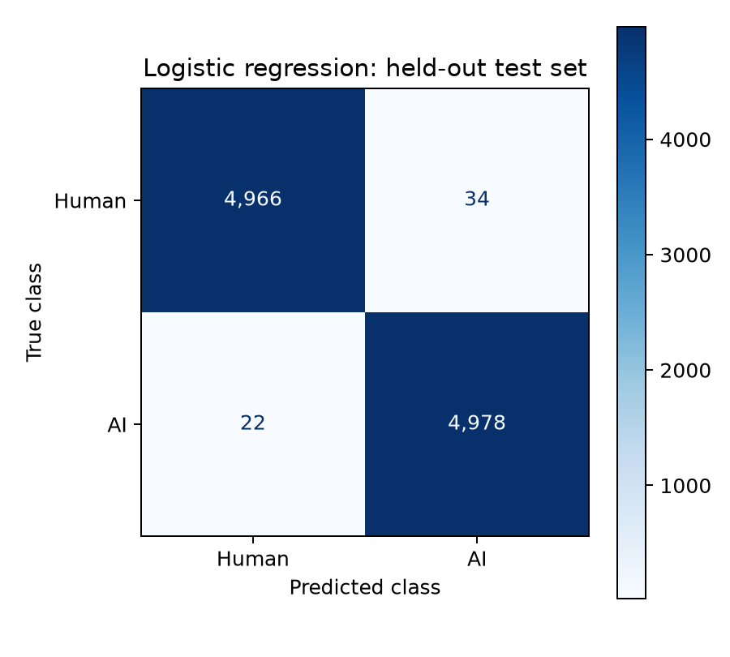
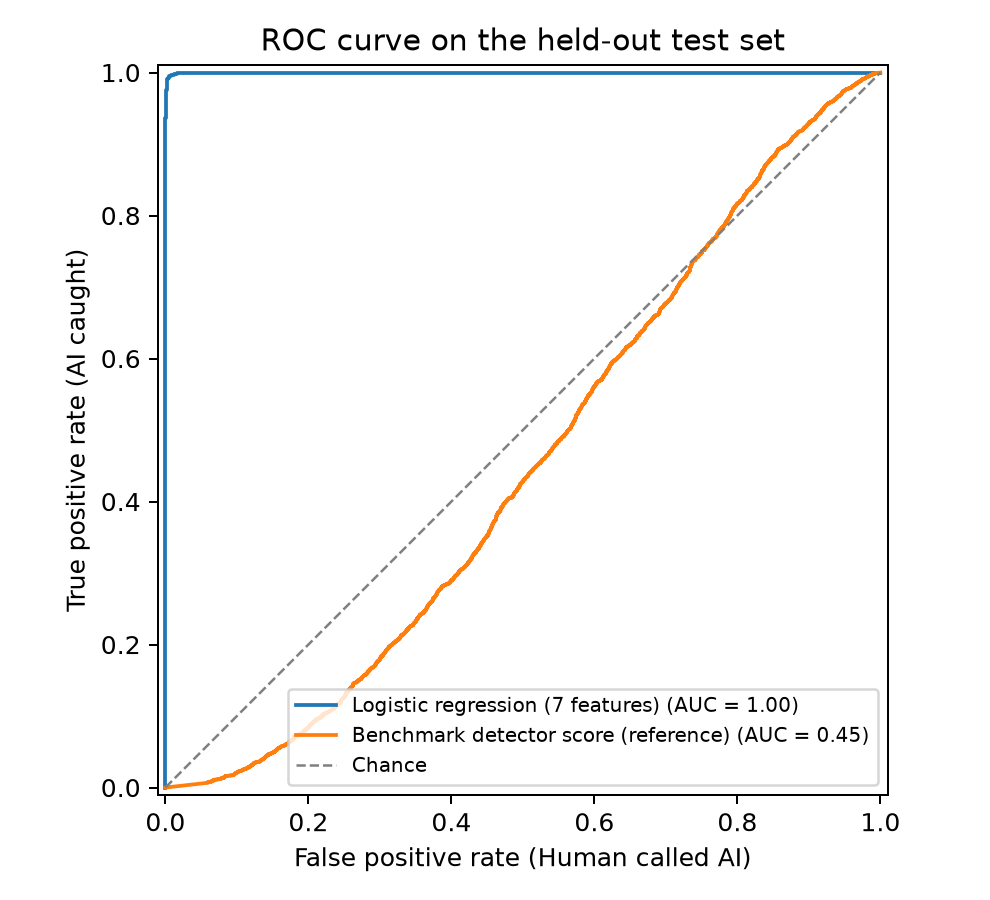
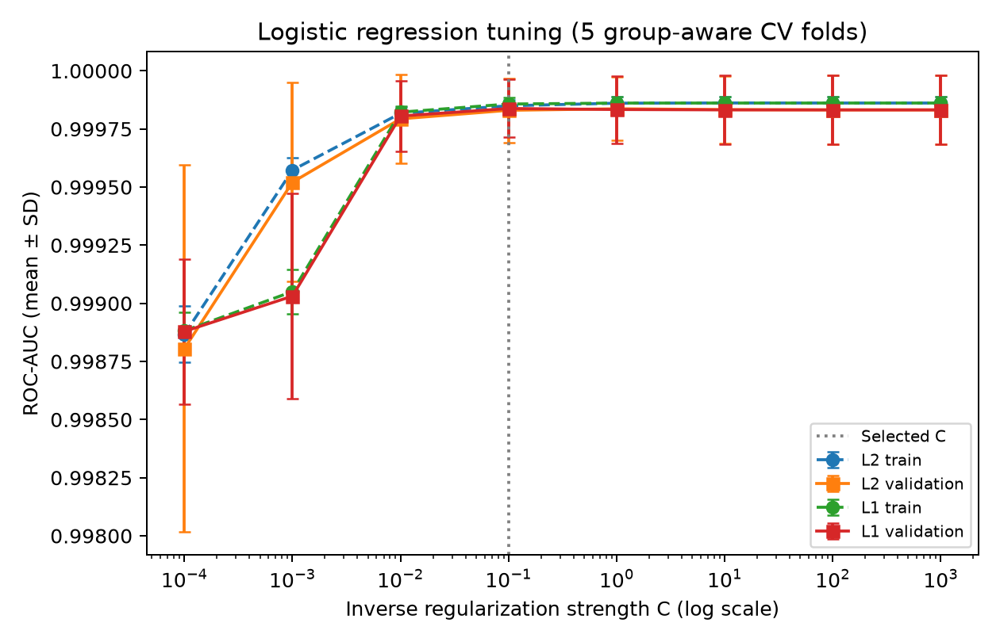
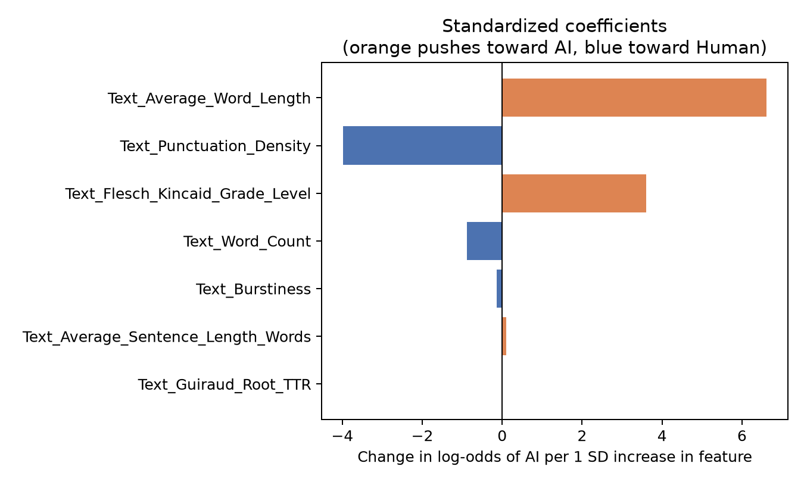
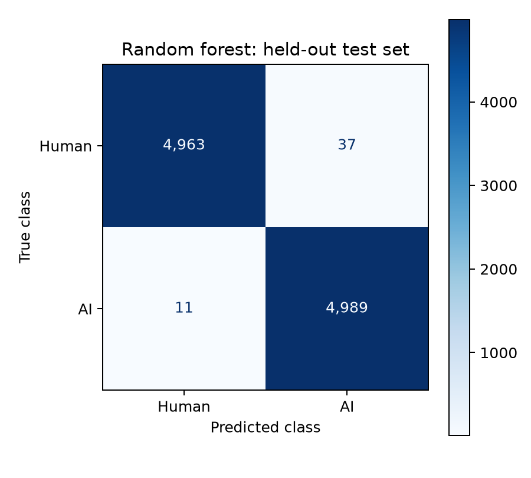
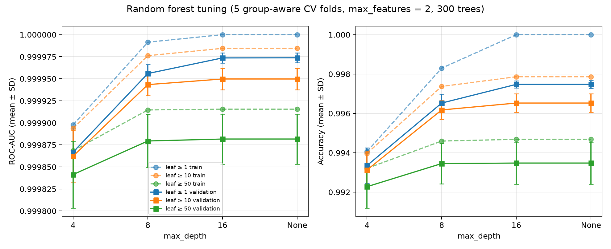
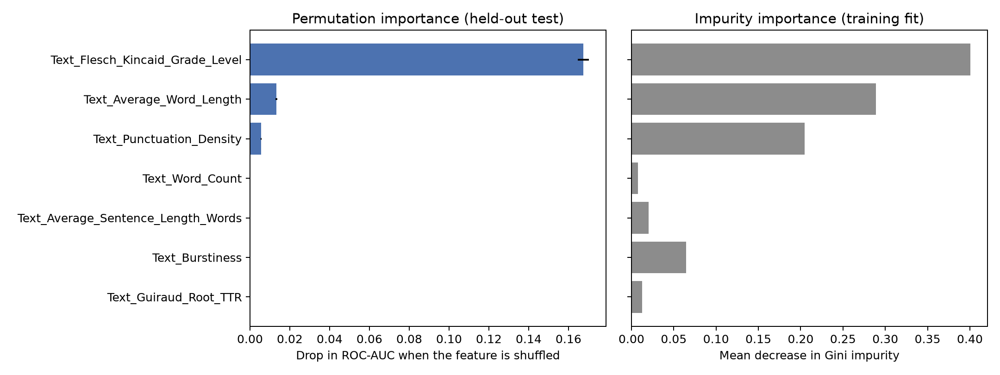
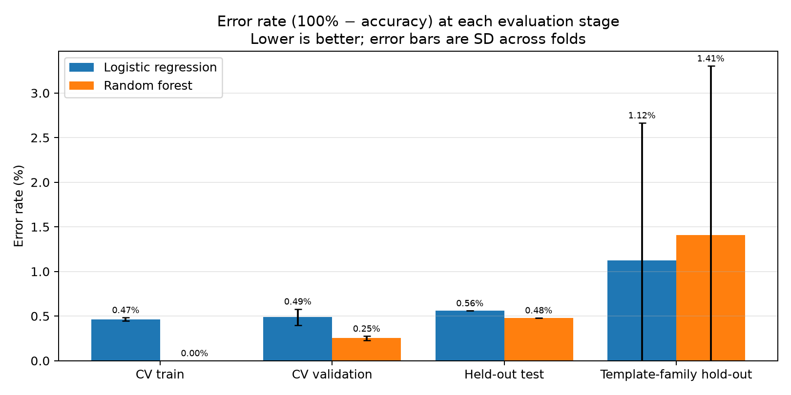
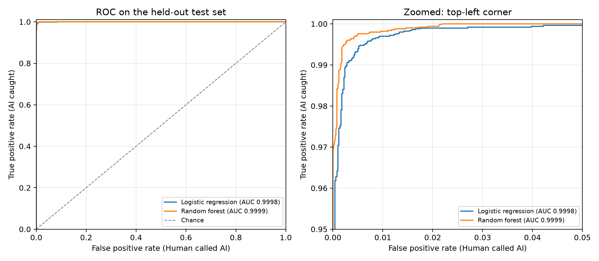

# Model Evaluation and Comparison

## Evaluation framework (shared by every model)

All models are evaluated with the helpers in `src/modeling.py`, so every
model uses the same inputs and folds:

- **Inputs:** the seven approved text-derived features only.
- **Split:** the near-duplicate-group-aware 40,000 / 10,000 train/test split
  and the five group-aware CV folds stored in
  `data/processed/human_ai_text_splits.csv` (see
  `data_preprocessing_and_exploration.md`).
- **Tuning:** on the training partition only, using the stored CV folds. The
  test partition is scored once, after the final configuration is chosen.
- **Stress test:** template-family hold-out CV on the training partition,
  where each validation fold contains whole writing templates the model never
  saw.
- **Reference:** the benchmark's `Detection_Score_Benchmark_Model_A`, scored
  on the same test rows. It is never a model input.

### Why these metrics

Positive class = AI (`Label = 1`).

| Metric | Why it is reported |
| --- | --- |
| Accuracy | Classes are exactly balanced (50/50 in every partition), so accuracy is not inflated by a majority class |
| Precision | Of texts flagged as AI, how many really are AI. A false accusation of AI use against a human writer is costly |
| Recall | Of AI texts, how many are caught |
| F1 | Single summary of the precision/recall balance |
| ROC-AUC | Threshold-free ranking quality; matters because the planned "API" returns a probability, not only a label |
| Confusion matrix | Shows which kind of error dominates |
| Train vs. validation gap | Over- or underfitting check required by the rubric |

## Model 1: Logistic regression

Script: `src/train_logistic_regression.py`. Notebook:
`notebooks/03_logistic_regression.ipynb`. Selected configuration: L1 penalty,
`C = 0.1` (tuning details in `model_development.md`).

### Results

| Evaluation | Accuracy | Precision | Recall | F1 | ROC-AUC |
| --- | --- | --- | --- | --- | --- |
| CV train (mean ± SD, 5 folds) | 0.9953 ± 0.0002 | 0.9955 ± 0.0002 | 0.9952 ± 0.0003 | 0.9953 ± 0.0002 | 0.9999 ± 0.0000 |
| CV validation (mean ± SD, 5 folds) | 0.9951 ± 0.0009 | 0.9951 ± 0.0018 | 0.9951 ± 0.0016 | 0.9951 ± 0.0009 | 0.9998 ± 0.0001 |
| Full training partition (40,000) | 0.9953 | 0.9954 | 0.9952 | 0.9953 | 0.9999 |
| **Held-out test (10,000)** | **0.9944** | **0.9932** | **0.9956** | **0.9944** | **0.9998** |
| Template-family hold-out validation (mean ± SD) | 0.9888 ± 0.0154 | 0.9908 ± 0.0151 | 0.9836 ± 0.0345 | 0.9869 ± 0.0198 | 0.9984 ± 0.0029 |
| Benchmark detector score, test (reference only, threshold 50) | 0.4870 | 0.4902 | 0.6472 | 0.5578 | 0.4480 |

Test confusion matrix (rows = true class, columns = predicted class):

| | Predicted Human | Predicted AI |
| --- | --- | --- |
| True Human | 4,966 | 34 |
| True AI | 22 | 4,978 |

### Over- or underfitting

There is no evidence of overfitting. CV train accuracy (0.9953) and validation
accuracy (0.9951) differ by 0.0002, and the test score (0.9944) is within
about one validation standard deviation. The tuning curve shows train and
validation ROC-AUC overlapping at every `C`. Only the strongest regularization
(`C <= 1e-3`) loses a little performance, which is mild underfitting. A model
with seven features and eight parameters has little capacity to memorize
40,000 rows.

### Interpretation

Standardized coefficients (change in log-odds of AI per one standard deviation):

| Feature | Coefficient | Reading |
| --- | --- | --- |
| `Text_Average_Word_Length` | +6.62 | Longer words → AI |
| `Text_Flesch_Kincaid_Grade_Level` | +3.60 | Harder-to-read text → AI |
| `Text_Average_Sentence_Length_Words` | +0.10 | Negligible |
| `Text_Guiraud_Root_TTR` | 0.00 | Dropped by L1 |
| `Text_Burstiness` | −0.14 | Slightly more uniform sentence lengths → AI |
| `Text_Word_Count` | −0.88 | Longer texts → slightly more Human |
| `Text_Punctuation_Density` | −3.99 | More punctuation per character → Human |

The AI templates in this benchmark use formal, polysyllabic vocabulary
("contemporary discourse", "stakeholders", "multifaceted"), while the Human
templates are conversational ("Let me tell you about…"). Word length and
readability capture that difference almost completely, so a linear model is
enough to separate the classes.

### Error analysis (initial)

- On the main test split, errors are rare (56 / 10,000) and roughly balanced:
  34 Human texts were called AI and 22 AI texts were called Human.
- The template-family hold-out is the more informative result. Four of five
  folds score 0.98–1.00 accuracy. The fold that holds out AI family 0
  (argumentative template, "*{Topic}* is often discussed in terms of its
  immediate impact…") together with Human families 9 and 10 drops to
  **0.965 accuracy and 0.922 AI recall**. An AI template the model has never
  seen is the realistic failure mode, and it is concentrated in one template.
- The benchmark's own detector score is worse than chance on these rows
  (ROC-AUC 0.448). That supports the earlier decision not to trust it as a
  feature, and makes it a weak external reference.

### Caveat for every result in this file

Near-perfect scores here mean the benchmark's 11 generator templates are
separable by simple style statistics. They do not show that real human versus
real LLM writing can be separated this well. Even the template-family hold-out
only tests generalization across 5 AI and 6 Human templates from one
synthetic generator.

## Model 2: Random forest

Script: `src/train_random_forest.py`. Notebook: `notebooks/04_random_forest.ipynb`.
Selected configuration: 300 trees, `max_depth = None`, `min_samples_leaf = 1`,
`max_features = 2` (tuning details in `model_development.md`).

### Results

| Evaluation | Accuracy | Precision | Recall | F1 | ROC-AUC |
| --- | --- | --- | --- | --- | --- |
| CV train (mean ± SD, 5 folds) | 1.0000 ± 0.0000 | 1.0000 ± 0.0000 | 1.0000 ± 0.0000 | 1.0000 ± 0.0000 | 1.0000 ± 0.0000 |
| CV validation (mean ± SD, 5 folds) | 0.9975 ± 0.0002 | 0.9974 ± 0.0005 | 0.9976 ± 0.0002 | 0.9975 ± 0.0002 | 1.0000 ± 0.0000 |
| Full training partition (40,000) | 1.0000 | 1.0000 | 1.0000 | 1.0000 | 1.0000 |
| **Held-out test (10,000)** | **0.9952** | **0.9926** | **0.9978** | **0.9952** | **0.9999** |
| Template-family hold-out validation (mean ± SD) | 0.9859 ± 0.0189 | 0.9886 ± 0.0174 | 0.9794 ± 0.0377 | 0.9837 ± 0.0236 | 0.9984 ± 0.0029 |

Test confusion matrix:

| | Predicted Human | Predicted AI |
| --- | --- | --- |
| True Human | 4,963 | 37 |
| True AI | 11 | 4,989 |

### Over- or underfitting

The selected forest fits the training data perfectly (1.0000), while
validation accuracy is 0.9975. A 0.25-point gap is expected for fully grown
trees and does not hurt validation: on the tuning curve, validation accuracy
rises with depth and levels off at depth 16, and shallow trees
(`max_depth = 4`) or large leaves (`min_samples_leaf = 50`) are
mildly *under*fit (validation about 0.993). The template-family hold-out tells
a different story: there the forest is slightly worse than logistic
regression (0.9859 vs. 0.9888). Its extra flexibility helps on texts from
templates it has seen and helps slightly less on templates it hasn't.

### Interpretation

Permutation importance on the held-out test set (drop in ROC-AUC when one
feature is shuffled):

| Feature | Permutation importance | Impurity importance |
| --- | --- | --- |
| `Text_Flesch_Kincaid_Grade_Level` | 0.168 | 0.401 |
| `Text_Average_Word_Length` | 0.013 | 0.289 |
| `Text_Punctuation_Density` | 0.006 | 0.205 |
| `Text_Word_Count` | 0.0002 | 0.008 |
| `Text_Average_Sentence_Length_Words` | 0.0001 | 0.020 |
| `Text_Burstiness` | 0.0001 | 0.065 |
| `Text_Guiraud_Root_TTR` | 0.0001 | 0.013 |

The forest relies on the same three features that logistic regression weights
most heavily. Permutation importance is measured on held-out data and is the
more trustworthy view. Impurity importance is computed on the training fit and
spreads credit across correlated features.

## Comparison

Script: `src/compare_models.py`. Notebook: `notebooks/05_model_comparison.ipynb`.
Both models used the same features, split, CV folds, selection metric, and
stress test.

| Stage | LR accuracy | RF accuracy | LR F1 | RF F1 | LR ROC-AUC | RF ROC-AUC |
| --- | --- | --- | --- | --- | --- | --- |
| CV train | 0.9953 | 1.0000 | 0.9953 | 1.0000 | 0.9999 | 1.0000 |
| CV validation | 0.9951 | 0.9975 | 0.9951 | 0.9975 | 0.9998 | 1.0000 |
| Held-out test | 0.9944 | 0.9952 | 0.9944 | 0.9952 | 0.9998 | 0.9999 |
| Unseen template families | **0.9888** | 0.9859 | **0.9869** | 0.9837 | 0.9984 | 0.9984 |

### Is the test-set difference real?

On the 10,000 test texts, logistic regression is wrong on 56 and the random
forest on 48. 32 of those are the same texts. Of the texts where exactly one
model is wrong, 24 are logistic-regression errors and 16 are random-forest
errors. An exact McNemar test on those 40 disagreements gives **p = 0.27**, so
the difference is not statistically significant.

### Error analysis

Errors are not random. They are concentrated in two templates:

| Template family | Class | Test rows | LR errors | RF errors |
| --- | --- | --- | --- | --- |
| 10 | Human | 925 | 28 | 34 |
| 0 | AI | 1,022 | 20 | 11 |
| 7 | Human | 795 | 6 | 3 |
| 3 | AI | 1,040 | 2 | 0 |
| other 7 families | both | 6,218 | 0 | 0 |

Family 10 has the highest reading grade of the human templates (median 12.2),
and family 0 has the lowest of the AI templates (median 15.2). Both models fail
where the two classes' styles overlap on the strongest feature. The same pair
drives the worst template-family hold-out fold for both models (LR 0.965,
RF 0.960 accuracy).

### Recommendation (draft for team review)

**Logistic regression.**

- The random forest's test advantage (8 fewer errors) is not significant
  (p = 0.27).
- Logistic regression generalizes slightly better to unseen templates, which
  is the closest proxy for new data that this benchmark offers.
- It has no train/validation gap, gives signed and directly explainable
  coefficients, and its full tuning grid runs in about 10 seconds versus
  about 3 minutes for the forest.
- The forest is still useful as a check: a much more flexible model found
  almost no additional signal and ranked the same features highest. So the
  linear boundary isn't leaving much on the table.

## Models 3–5

Pending (Linear SVM, Gradient Boosting, K-Nearest Neighbors). Each should
reuse `src/modeling.py` (`load_model_data`, `predefined_cv`,
`template_family_holdout`, `classification_metrics`, `save_test_predictions`),
be added to `MODELS` in `src/compare_models.py`, and get its own notebook.
