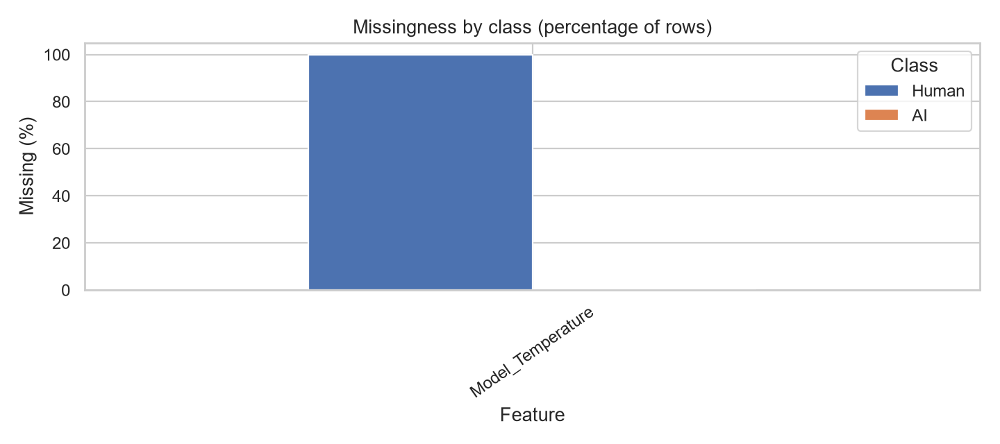
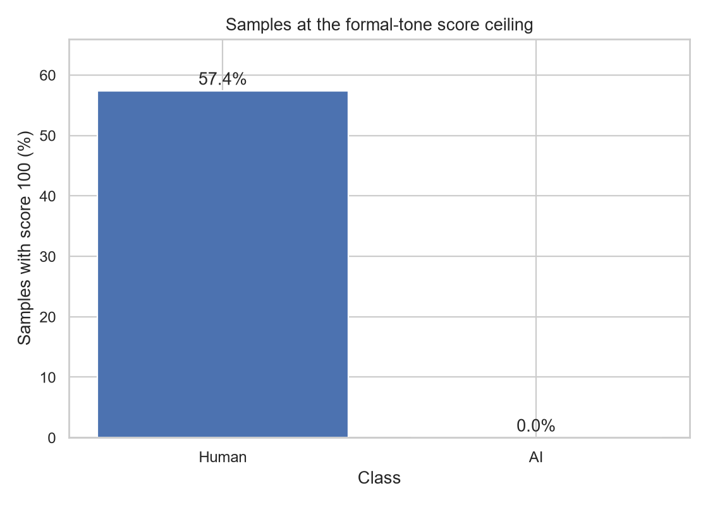
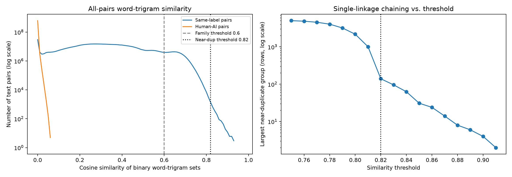

# Human vs. AI Text Classification

## Final Project Data Definition and Preprocessing Decisions

**Course:** CSCE 478/878 — Intro to Machine Learning  
**Task:** Binary classification of human-written versus AI-generated text  
**Status:** Data-understanding and preprocessing-design report; final processed CSV is not yet frozen

## 1. Problem definition

The project investigates whether a text sample can be classified as Human or AI
using measurable properties of the submitted text. Each row represents one text
sample. The prediction target is `Label`, where `0 = Human` and `1 = AI`.

This is a supervised binary-classification problem. The intended deployment
boundary is important: a future prediction must be possible from an arbitrary
text snippet alone. The model may not depend on the generating model, prompt
type, generation temperature, an existing detector's output, or any other
metadata unavailable from the text itself.

The project seeks to answer four questions:

1. Which measurable properties of text distinguish the two classes in this
   benchmark?
2. Which fields are genuine text-derived inputs versus dataset-construction
   artifacts or unavailable metadata?
3. How do two different supervised models compare when they use the same
   leakage-aware feature policy?
4. How much confidence should be placed in the results given the benchmark's
   construction, possible redundancy, and possible template or near-duplicate
   contamination?

## 2. Dataset and data understanding

The dataset is the Kaggle benchmark
[`datascikhan/ai-vs-human-text-classification-benchmark-50k`](https://www.kaggle.com/datasets/datascikhan/ai-vs-human-text-classification-benchmark-50k),
downloaded through KaggleHub. The local copy contains 50,000 rows and 30
columns, with 25,000 Human and 25,000 AI observations. The raw CSV is treated
as immutable; derived files are written under `data/processed/`.

*Figure 1. The local dataset has balanced Human and AI classes.*

`Text_ID` is unique for all rows, and `Raw_Text` is unique for all rows in the
local audit. Required fields do not contain missing values. `Model_Temperature`
has structural missingness: it is absent for Human rows and present for AI rows.
`Contains_Code_Snippet` is constant at zero in the local data.

*Figure 2. Missingness is class-associated for `Model_Temperature`, so ordinary
missing-value imputation would encode the benchmark construction into the
model.*

The dataset includes source and generation metadata. These fields are strongly
associated with the target because Human and AI examples were constructed from
different source groups.

*Figure 3. Metadata categories are closely aligned with the target and therefore
cannot be treated as neutral text evidence for this deployment goal.*

## 3. Approved feature policy

The following decisions define the current modeling boundary:

| Field or group | Decision | Rationale |
| --- | --- | --- |
| `Raw_Text` | Retain in the processed CSV for traceability; do not use directly as a tabular numeric input | Preserves auditability while keeping the feature matrix explicit |
| `Text_ID` | Retain only for traceability; exclude from model inputs | It identifies a row and contains no text evidence |
| Text-derived measurements | Candidate model inputs, subject to redundancy review | They can be recomputed from arbitrary text |
| `Source_Model`, `Model_Size`, `Model_Temperature`, `Generation_Prompt_Type`, `RAG_Context_Provided` | Exclude | These describe benchmark construction, not arbitrary submitted text |
| `Detection_Score_Benchmark_Model_A` | Evaluation-only | It is another detector's output and is unavailable at model-input time |
| `Formal_Tone_Score` | Exclude from the initial input policy | Formality can be intentionally changed by prompting, and this field has an unexplained class-associated artifact |
| `Contains_Code_Snippet` | Exclude | It is constant in the local dataset and has no discriminative variation |
| `Label` | Target only | Using it as an input would be direct target leakage |

The benchmark detector score may be compared with model predictions on held-out
test data as an external correctness reference, but it must never enter either
model's feature matrix.

## 4. Formal-tone exclusion

`Formal_Tone_Score` is not accepted as an initial model input. The local data
contains a large concentration of Human samples at exactly 100, while AI values
occupy a very different range. This may reflect a scoring ceiling, different
feature-generation procedures, a benchmark artifact, or a genuine text
relationship. The provenance is not documented well enough to justify using it
for an arbitrary-text detector. Additionally, a user can deliberately prompt an
AI system to write more formally or casually, making this property manipulable.

*Figure 4. The formal-tone score has a large Human concentration at its maximum
value, which motivates excluding it pending provenance evidence.*

The raw field remains available for exploratory documentation and possible
sensitivity analysis, but exclusion is the default policy for the two required
models.

## 5. Text-derived feature definitions

All accepted model inputs must be computed from the submitted string `s` using
documented deterministic rules. Let `W = (w_1, ..., w_n)` be the word tokens,
`S` the detected sentence spans, `U` the set of lowercased word tokens, and `P`
the punctuation count.

The current specification is:

| Feature | Mathematical definition |
| --- | --- |
| Word count | `n = |W|` |
| Character count | Number of Unicode code points in normalized text |
| Sentence count | `|S|`, using boundaries ending in `.`, `!`, or `?` |
| Unique-word count | `|U|`, where `U = {lower(w): w in W}` |
| Lexical diversity | `|U| / n` |
| Average word length | `sum(length(w_i)) / n` |
| Average sentence length | `n / |S|` |
| Punctuation count | Number of Unicode punctuation-category characters |
| Punctuation density | `P / max(1, character_count)` |
| Special-character count | Characters outside letters, numbers, whitespace, and punctuation |
| Stopword count | `sum_i I(lower(w_i) in D)`, using a versioned stopword set `D` |
| Stopword density | `stopword_count / n` |
| Capital-letter count | Count of uppercase alphabetic Unicode characters |
| Average syllables per word | `sum(syllables(w_i)) / n`, using a fixed, versioned syllable algorithm |

Whitespace is normalized by replacing each whitespace run with one space and
trimming the ends. Empty text receives a documented missing-value treatment;
the project will not silently convert an empty text into an ordinary example.

The existing dataset also contains readability, emotion, coherence, burstiness,
and other engineered scores. Their original generator formulas are not fully
documented in the source material. They therefore cannot be called exactly
reproducible model inputs until the project implements and versions their
algorithms. The complete specification and this limitation are recorded in
[`rubric_explanation/feature_derivation_spec.md`](rubric_explanation/feature_derivation_spec.md).

The first equation-by-equation comparison against the local columns is recorded
in [`rubric_explanation/feature_formula_verification.md`](rubric_explanation/feature_formula_verification.md).
It shows that the stored lexical-diversity column matches ordinary type-token
ratio rather than Guiraud's index, while the proposed Flesch-Kincaid equation
is standard but not exactly reproducible from the stored intermediate values.
The public dataset description does not disclose the original feature-
generation equations or implementation, and the associated notebook source was
not available in a usable form during this review. This is recorded as a source
dataset reproducibility limitation; undocumented formulas will not be inferred
from column names alone.

Accordingly, the project has chosen to independently derive a candidate feature
set from `Raw_Text` using the documented rules and implementation in
[`src/text_features.py`](src/text_features.py). The intermediate artifact is
created by [`src/build_candidate_features.py`](src/build_candidate_features.py)
and is used for feature-review visuals. This independently derived matrix is
the basis for the next redundancy decision; the final processed CSV remains
unfrozen until that review is complete.

## 6. Redundancy analysis

Correlation is used as a diagnostic rather than an automatic feature-deletion
rule. For numeric features `x` and `y`, Pearson correlation is:

`r_xy = sum_i ((x_i - mean(x))(y_i - mean(y))) / sqrt(sum_i (x_i - mean(x))^2 sum_i (y_i - mean(y))^2)`

The correlation matrix shows strong expected relationships among text-length
features. For example, the local data has correlations of approximately 0.996
between word count and character count, 0.994 between word count and sentence
count, 0.988 between word count and punctuation count, and 0.997 between word
count and capital-letter count.

*Figure 5. Annotated Pearson correlations among independently derived candidate
text features. This replaces the earlier matrix based on undocumented source
columns. The values identify redundancy candidates; they do not independently
determine which feature should be removed.*

*Figure 6. Class-conditional distributions of selected independently derived
features used to inspect scale, overlap, and possible redundancy before model
selection.*

The approved reduced policy keeps one representative from each major signal
family: word count, average word length, average sentence length, Guiraud root
TTR, punctuation density, Flesch-Kincaid grade level, and independently derived
burstiness. It removes highly redundant raw counts, ordinary TTR, the constant
special-character count, and average syllables per word because that signal is
already represented in the retained readability feature. The full candidate
artifact will be compared against this reduced policy using grouped
cross-validation; if performance is similar, the reduced policy is preferred.

The reduced artifact is generated and validated by
[`src/prepare_final_data.py`](src/prepare_final_data.py).

### Final processed-data schema

The final reduced CSV contains the following traceability, target, and model
columns:

| Column | Role |
| --- | --- |
| `Text_ID` | Traceability identifier; excluded from model inputs |
| `Raw_Text` | Original text; retained for traceability, not used as a tabular input |
| `Label` | Binary target: `0 = Human`, `1 = AI` |
| `Label_Name` | Readable target label; excluded from model inputs |
| `Text_Word_Count` | Model feature: text length |
| `Text_Average_Word_Length` | Model feature: average word length |
| `Text_Average_Sentence_Length_Words` | Model feature: sentence structure |
| `Text_Guiraud_Root_TTR` | Model feature: length-adjusted lexical diversity |
| `Text_Punctuation_Density` | Model feature: punctuation normalized by character count |
| `Text_Flesch_Kincaid_Grade_Level` | Model feature: readability |
| `Text_Burstiness` | Model feature: variation in sentence lengths |

The model feature matrix therefore consists of exactly seven columns:
`Text_Word_Count`, `Text_Average_Word_Length`,
`Text_Average_Sentence_Length_Words`, `Text_Guiraud_Root_TTR`,
`Text_Punctuation_Density`, `Text_Flesch_Kincaid_Grade_Level`, and
`Text_Burstiness`.

The final model matrix excludes source and generation metadata, the benchmark
detector score, `Formal_Tone_Score`, undocumented emotion/coherence scores,
highly redundant raw counts, the constant special-character count, ordinary
type-token ratio, and average syllables per word.

The detailed preprocessing rationale is maintained in
[`rubric_explanation/data_preprocessing_and_exploration.md`](rubric_explanation/data_preprocessing_and_exploration.md),
and the exact independently derived feature rules are maintained in
[`rubric_explanation/feature_derivation_spec.md`](rubric_explanation/feature_derivation_spec.md).

## 7. Duplicate and near-duplicate controls

The exact duplicate audit found zero repeated `Raw_Text` values. A conservative
normalization that lowercases text, collapses whitespace, and trims the result
also found zero repeated values.

*Figure 7. Exact and conservative normalized duplicate audit. Zero exact
duplicates does not rule out paraphrases, shared templates, or topic leakage.*

Near-duplicate detection was then run over all 1.25 billion text pairs using
the cosine overlap of word-trigram sets (`src/build_splits.py`). It revealed
that the benchmark is template-generated: the corpus consists of 11 writing
templates (6 Human, 5 AI) filled with a topic and perturbed by random word
swaps. Every template family is single-class, every text's nearest neighbor has
the same label, and no Human/AI pair shares more than 6% of its trigrams.

Near-duplicates were defined as pairs more similar than template-sharing alone
explains. The threshold 0.82 sits above the 99.99th percentile of within-family
similarity (0.80) and just past the point where single-linkage chaining stops
merging whole families (largest group 1,011 rows at 0.81 vs. 140 at 0.82). The
resulting 47,779 groups drive a stratified, group-aware 40,000/10,000
train/test split and five CV folds (exactly 50% AI in every partition). Whole
template families are additionally held out as a generalization stress test.
Full details are in
[`rubric_explanation/data_preprocessing_and_exploration.md`](rubric_explanation/data_preprocessing_and_exploration.md).

*Figure 8. Left: all-pairs similarity; Human-AI pairs never exceed 0.06. Right:
largest near-duplicate group versus threshold; chaining collapses at 0.82.*

## 7a. First model result: logistic regression

A standardized, L1-regularized logistic regression (`C = 0.1`, chosen by
group-aware CV over 16 configurations) reaches 0.9944 accuracy, 0.9944 F1, and
0.9998 ROC-AUC on the untouched test set, with a negligible train/validation
gap. When whole templates are held out, validation accuracy is 0.989 ± 0.015,
falling to 0.965 on the fold whose AI template is hardest. Average word length,
Flesch-Kincaid grade, and punctuation density carry almost all of the signal.
The benchmark's own detector score reaches only 0.448 ROC-AUC on the same test
rows. Because of the template structure, these numbers describe this benchmark,
not real-world AI detection. Full results:
[`rubric_explanation/model_eval_and_comparison.md`](rubric_explanation/model_eval_and_comparison.md).

## 7b. Second model: random forest, and comparison

A 300-tree random forest (fully grown trees, `max_features = 2`, chosen by the
same group-aware CV over 36 configurations) reaches 0.9952 test accuracy and
0.9999 ROC-AUC. It fits the training data perfectly (validation 0.9975), and
on unseen templates it is slightly worse than logistic regression (0.9859 vs.
0.9888). It makes 48 test errors versus 56 for logistic regression, but an
exact McNemar test finds the difference not significant (p = 0.27). Both
models make almost all of their errors in two templates: the most formal
human template and the least formal AI template. Permutation importance ranks
the same three features highest as the logistic-regression coefficients. The
draft recommendation is logistic regression: the same accuracy within noise,
better generalization to unseen templates, no overfitting gap, and directly
interpretable. Walkthrough: `notebooks/05_model_comparison.ipynb`.

## 8. Leakage-aware preprocessing plan

Next Step:

1. ~~Audit near-duplicate and template similarity before splitting.~~ Done.
2. ~~Create a reproducible stratified train/test split, or a group-aware split if
   similarity groups require it.~~ Done (group-aware).
3. Fit imputers, encoders, scalers, and feature-selection procedures using only
   the training partition.
4. Apply the fitted transformations unchanged to validation and test data.
5. Train four or five different models under the same feature matrix and split
   policy. (Logistic regression and random forest done; linear SVM, gradient
   boosting, and KNN pending.)
6. Evaluate accuracy, precision, recall, F1, ROC-AUC, confusion matrices, and
   train/test differences as appropriate for the project.
7. Use the benchmark detector score only as an evaluation reference.
8. Write and validate the final processed CSV with its schema, row count,
   target values, missingness policy, and transformation configuration.

## 9. Model-development handoff

The planned model comparison contains five candidates:

1. Logistic regression — interpretable regularized linear baseline.
2. Linear support-vector machine — alternative margin-based linear model.
3. Random forest — nonlinear ensemble for thresholds and interactions.
4. Gradient boosting — nonlinear additive ensemble for structured interactions.
5. K-nearest neighbors — scaled distance-based diagnostic for feature geometry.

All models will use the same grouped cross-validation folds, preprocessing
rules, feature policies, and evaluation metrics. The reduced seven-feature
matrix will be compared with the full independently derived candidate matrix.
If performance is similar, the reduced matrix will be preferred for
interpretability. The complete model rationale, tuning parameters, and
comparison rules are documented in
[`rubric_explanation/model_development.md`](rubric_explanation/model_development.md).

## 10. Current limitations

The benchmark may contain source-specific writing patterns that make the task
easier than real-world authorship detection. Engineered variables may also
duplicate the same underlying length or style signal. The dataset's source
construction and the undocumented formulas of some existing engineered fields
limit claims of generalization. Results should therefore be described as
performance on this benchmark under the stated feature policy, not as proof of
universal Human/AI authorship detection.

## 11. Current definition of done

The preprocessing stage is complete only when:

- the final approved feature list is documented;
- every model input has an exact, reproducible derivation from text;
- duplicate and near-duplicate handling is documented;
- transformations are leakage-safe and reproducible;
- `Raw_Text` and traceability fields are preserved as approved;
- the final processed CSV is written under `data/processed/`; and
- the CSV passes schema, row-count, target, missingness, and reproducibility
  checks.

At this report checkpoint, the final processed CSV has intentionally not been
frozen because redundancy and near-duplicate decisions remain under review. The
candidate independently derived CSV is an exploratory intermediate artifact,
not the final deliverable.
