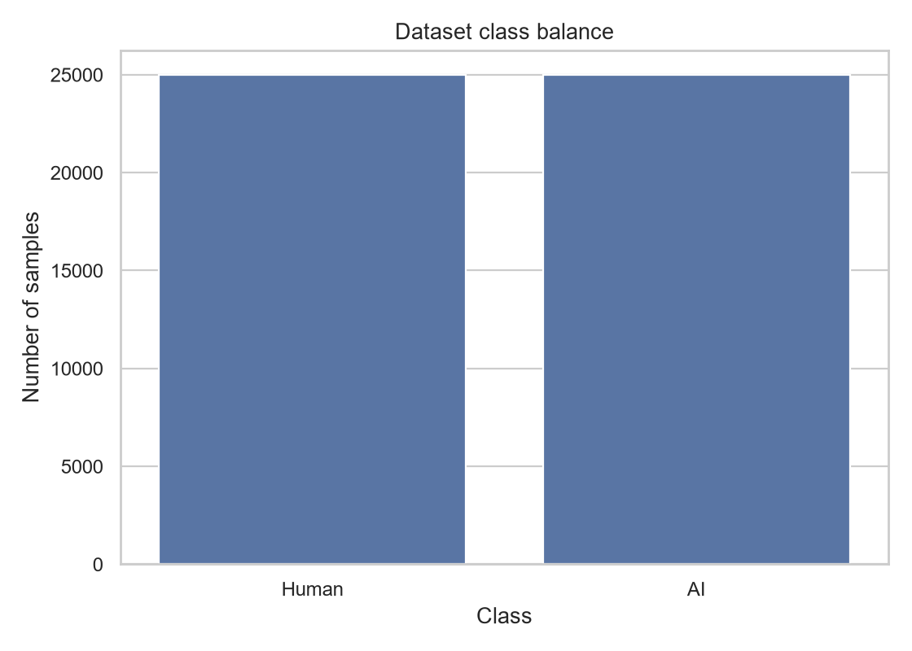
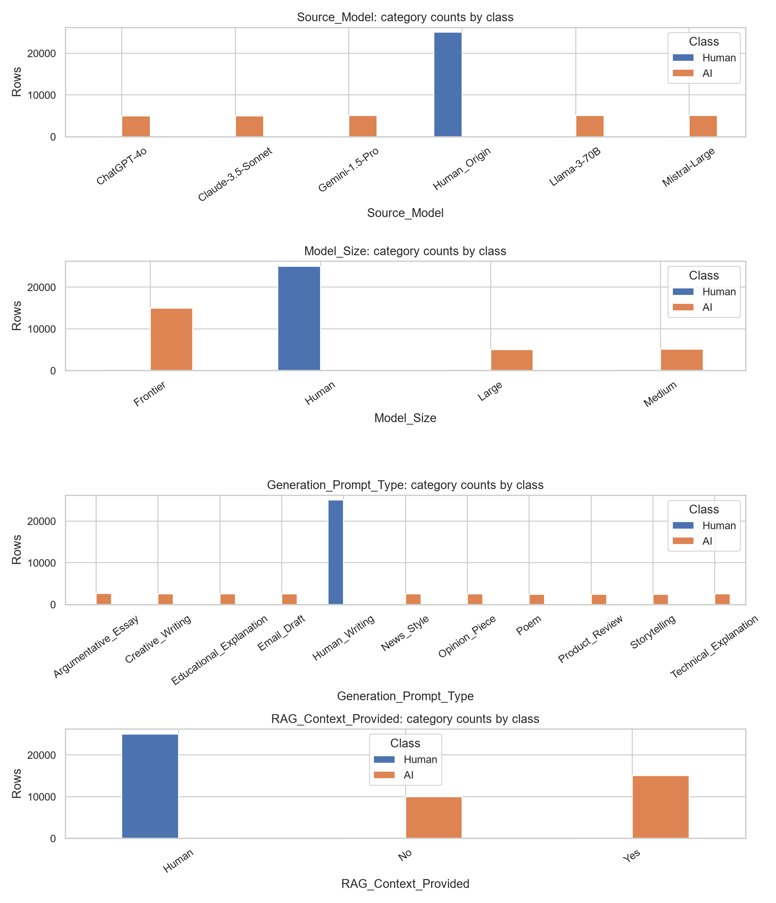
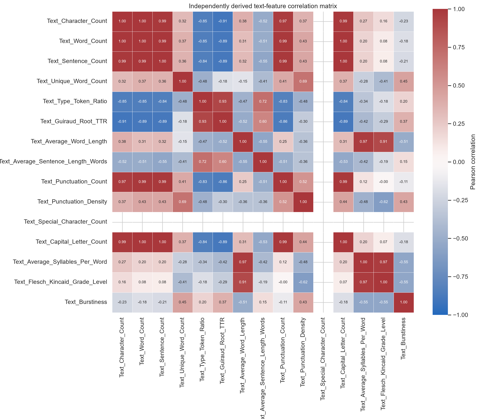
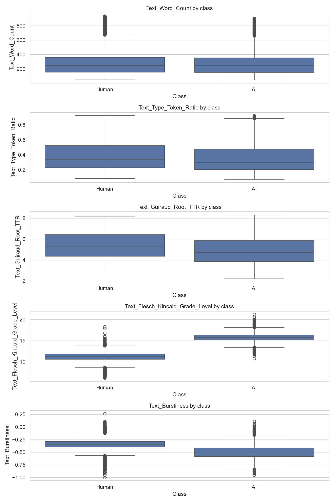
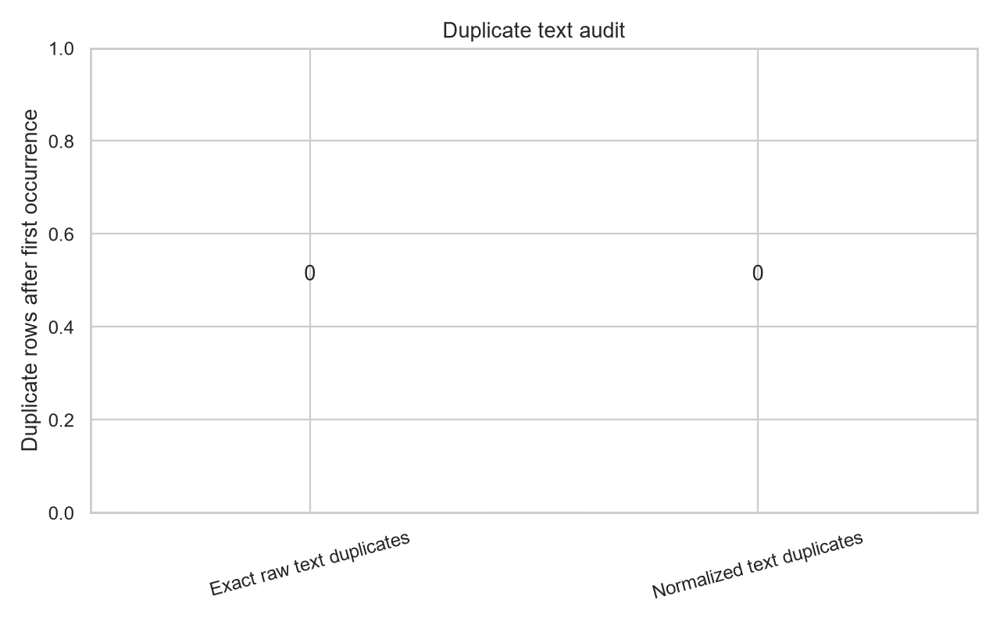
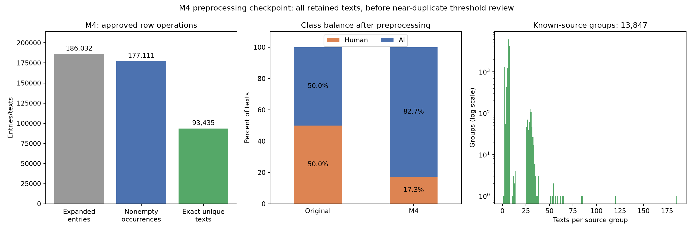
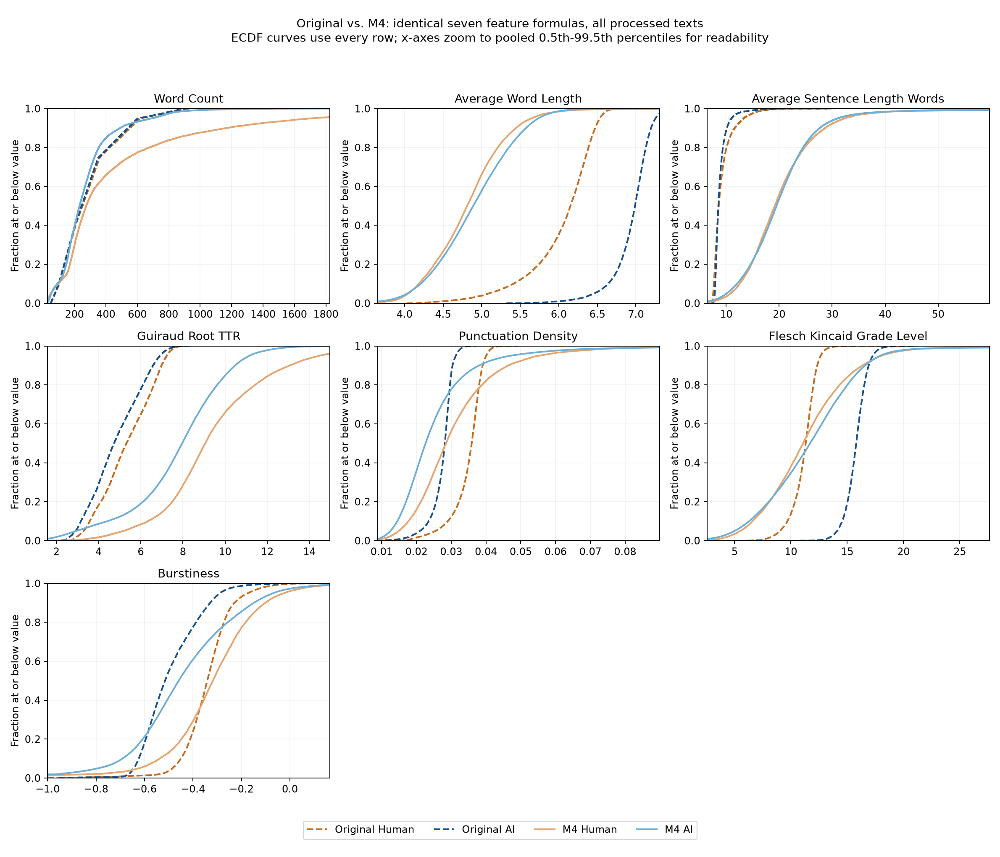
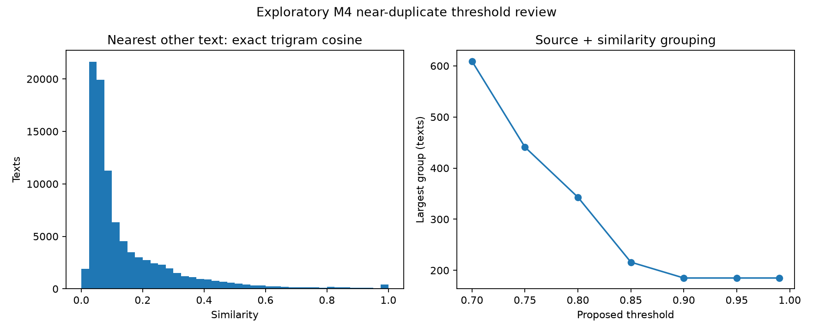
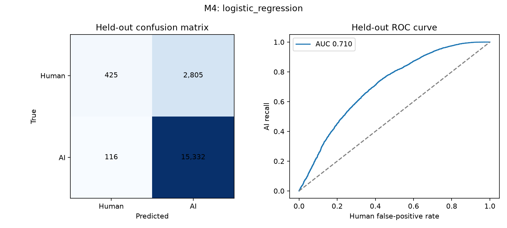

# Human vs. AI Text Classification

## Original Benchmark Study and M4 Extension

**Course:** CSCE 478/878 — Intro to Machine Learning  
**Task:** Binary classification of human-written versus AI-generated text  
**Status:** Original study and M4 extension complete: preprocessing, splits, transfer evaluation, and LR and RF retrained on M4. Recommended model: random forest (section 11.7b)

**Contents:** Part A, original benchmark — [1 Problem](#1-problem-definition) · [2 Data](#2-dataset-and-data-understanding) · [3 Feature policy](#3-approved-feature-policy) · [4 Formal tone](#4-formal-tone-exclusion) · [5 Features](#5-text-derived-feature-definitions) · [6 Redundancy](#6-redundancy-analysis) · [7 Near-duplicates](#7-duplicate-and-near-duplicate-controls) · [7a LR](#7a-first-model-result-logistic-regression) · [7b RF](#7b-second-model-random-forest-and-comparison) · [8 Plan](#8-leakage-aware-preprocessing-plan) · [9 Models](#9-model-development-handoff) · [10 Limitations](#10-original-benchmark-limitations-and-reason-for-a-second-dataset) <br> Part B, M4 extension — [11 M4](#11-second-dataset-m4) · [11.6 Transfer](#116-evaluation-design-and-transfer-results) · [11.7 M4 LR](#117-m4-logistic-regression-result-and-interpretation) · [11.7b M4 RF and recommendation](#117b-m4-random-forest-result-and-model-recommendation) · [11.8 Next steps](#118-proposed-improvements-and-next-steps) · [12 Done criteria](#12-current-definition-of-done)

## 1. Problem definition

The project investigates whether a text sample can be classified as Human or AI using measurable properties of the submitted text. Each row represents one text sample. The prediction target is `Label`, where `0 = Human` and `1 = AI`.

This is a supervised binary-classification problem. The intended deployment boundary is important: a future prediction must be possible from an arbitrary text snippet alone. The model may not depend on the generating model, prompt type, generation temperature, an existing detector's output, or any other metadata unavailable from the text itself.

The project seeks to answer four questions:

1. Which measurable properties of text distinguish the two classes in this benchmark?
2. Which fields are genuine text-derived inputs versus dataset-construction artifacts or unavailable metadata?
3. How do two different supervised models compare when they use the same leakage-aware feature policy?
4. How much confidence should be placed in the results given the benchmark's construction, possible redundancy, and possible template or near-duplicate contamination?

## 2. Dataset and data understanding

The dataset is the Kaggle benchmark [`datascikhan/ai-vs-human-text-classification-benchmark-50k`](https://www.kaggle.com/datasets/datascikhan/ai-vs-human-text-classification-benchmark-50k), downloaded through KaggleHub. The local copy contains 50,000 rows and 30 columns, with 25,000 Human and 25,000 AI observations. The raw CSV is treated as immutable; derived files are written under `data/processed/`.



*Figure 1. The local dataset has balanced Human and AI classes.*

`Text_ID` is unique for all rows, and `Raw_Text` is unique for all rows in the local audit. Required fields do not contain missing values. `Model_Temperature` has structural missingness: it is absent for Human rows and present for AI rows. `Contains_Code_Snippet` is constant at zero in the local data.


*Figure 2. Missingness is class-associated for `Model_Temperature`, so ordinary missing-value imputation would encode the benchmark construction into the model.*

The dataset includes source and generation metadata. These fields are strongly associated with the target because Human and AI examples were constructed from different source groups.



*Figure 3. Metadata categories are closely aligned with the target and therefore cannot be treated as neutral text evidence for this deployment goal.*

## 3. Approved feature policy

The following decisions define the current modeling boundary:

| Field or group | Decision | Rationale |
| --- | --- | --- |
| `Raw_Text` | Retain in the processed CSV for traceability; do not use directly as a tabular numeric input | Preserves auditability while keeping the feature matrix explicit |
| `Text_ID` | Retain only for traceability; exclude from model inputs | It identifies a row and contains no text evidence |
| Text-derived measurements | Candidate model inputs, subject to redundancy review | They can be recomputed from arbitrary text |
| `Source_Model`, `Model_Size`, `Model_Temperature`, `Generation_Prompt_Type`, `RAG_Context_Provided` | Exclude | These describe benchmark construction, not arbitrary submitted text |
| `Detection_Score_Benchmark_Model_A` | Evaluation-only | It is another detector's output and is unavailable at model-input time |
| `Formal_Tone_Score` | Exclude from the initial input policy | Formality can be intentionally changed by prompting, and this field has an unexplained class-associated artifact |
| `Contains_Code_Snippet` | Exclude | It is constant in the local dataset and has no discriminative variation |
| `Label` | Target only | Using it as an input would be direct target leakage |

The benchmark detector score may be compared with model predictions on held-out test data as an external correctness reference, but it must never enter either model's feature matrix.

## 4. Formal-tone exclusion

`Formal_Tone_Score` is not accepted as an initial model input. The local data contains a large concentration of Human samples at exactly 100, while AI values occupy a very different range. This may reflect a scoring ceiling, different feature-generation procedures, a benchmark artifact, or a genuine text relationship. The provenance is not documented well enough to justify using it for an arbitrary-text detector. Additionally, a user can deliberately prompt an AI system to write more formally or casually, making this property manipulable.


*Figure 4. The formal-tone score has a large Human concentration at its maximum value, which motivates excluding it pending provenance evidence.*

The raw field remains available for exploratory documentation and possible sensitivity analysis, but exclusion is the default policy for the two required models.

## 5. Text-derived feature definitions

All accepted model inputs must be computed from the submitted string `s` using documented deterministic rules. Let `W = (w_1, ..., w_n)` be the word tokens, `S` the detected sentence spans, `U` the set of lowercased word tokens, and `P` the punctuation count.

The current specification is:

| Feature | Mathematical definition |
| --- | --- |
| Word count | `n = |W|` |
| Character count | Number of Unicode code points in normalized text |
| Sentence count | `|S|`, using boundaries ending in `.`, `!`, or `?` |
| Unique-word count | `|U|`, where `U = {lower(w): w in W}` |
| Lexical diversity | `|U| / n` |
| Average word length | `sum(length(w_i)) / n` |
| Average sentence length | `n / |S|` |
| Punctuation count | Number of Unicode punctuation-category characters |
| Punctuation density | `P / max(1, character_count)` |
| Special-character count | Characters outside letters, numbers, whitespace, and punctuation |
| Stopword count | `sum_i I(lower(w_i) in D)`, using a versioned stopword set `D` |
| Stopword density | `stopword_count / n` |
| Capital-letter count | Count of uppercase alphabetic Unicode characters |
| Average syllables per word | `sum(syllables(w_i)) / n`, using a fixed, versioned syllable algorithm |

Whitespace is normalized by replacing each whitespace run with one space and trimming the ends. Empty text receives a documented missing-value treatment; the project will not silently convert an empty text into an ordinary example.

The existing dataset also contains readability, emotion, coherence, burstiness, and other engineered scores. Their original generator formulas are not fully documented in the source material. They therefore cannot be called exactly reproducible model inputs until the project implements and versions their algorithms. The complete specification and this limitation are recorded in [`docs/feature_derivation_spec.md`](docs/feature_derivation_spec.md).

The first equation-by-equation comparison against the local columns is recorded in [`docs/feature_formula_verification.md`](docs/feature_formula_verification.md). It shows that the stored lexical-diversity column matches ordinary type-token ratio rather than Guiraud's index, while the proposed Flesch-Kincaid equation is standard but not exactly reproducible from the stored intermediate values. The public dataset description does not disclose the original feature- generation equations or implementation, and the associated notebook source was not available in a usable form during this review. This is recorded as a source dataset reproducibility limitation; undocumented formulas will not be inferred from column names alone.

Accordingly, the project has chosen to independently derive a candidate feature set from `Raw_Text` using the documented rules and implementation in [`src/text_features.py`](src/text_features.py). The intermediate artifact is created by [`src/build_candidate_features.py`](src/build_candidate_features.py) and is used for feature-review visuals. This independently derived matrix is the basis for the redundancy review. The reduced seven-feature policy described below was subsequently approved and its processed CSV was generated and validated.

## 6. Redundancy analysis

Correlation is used as a diagnostic rather than an automatic feature-deletion rule. For numeric features `x` and `y`, Pearson correlation is:

`r_xy = sum_i ((x_i - mean(x))(y_i - mean(y))) / sqrt(sum_i (x_i - mean(x))^2 sum_i (y_i - mean(y))^2)`

The correlation matrix shows strong expected relationships among text-length features. For example, the local data has correlations of approximately 0.996 between word count and character count, 0.994 between word count and sentence count, 0.988 between word count and punctuation count, and 0.997 between word count and capital-letter count.



*Figure 5. Annotated Pearson correlations among independently derived candidate text features. This replaces the earlier matrix based on undocumented source columns. The values identify redundancy candidates; they do not independently determine which feature should be removed.*



*Figure 6. Class-conditional distributions of selected independently derived features used to inspect scale, overlap, and possible redundancy before model selection.*

The approved reduced policy keeps one representative from each major signal family: word count, average word length, average sentence length, Guiraud root TTR, punctuation density, Flesch-Kincaid grade level, and independently derived burstiness. It removes highly redundant raw counts, ordinary TTR, the constant special-character count, and average syllables per word because that signal is already represented in the retained readability feature. The full candidate artifact will be compared against this reduced policy using grouped cross-validation; if performance is similar, the reduced policy is preferred.

The reduced artifact is generated and validated by [`src/prepare_final_data.py`](src/prepare_final_data.py).

### Final processed-data schema

The final reduced CSV contains the following traceability, target, and model columns:

| Column | Role |
| --- | --- |
| `Text_ID` | Traceability identifier; excluded from model inputs |
| `Raw_Text` | Original text; retained for traceability, not used as a tabular input |
| `Label` | Binary target: `0 = Human`, `1 = AI` |
| `Label_Name` | Readable target label; excluded from model inputs |
| `Text_Word_Count` | Model feature: text length |
| `Text_Average_Word_Length` | Model feature: average word length |
| `Text_Average_Sentence_Length_Words` | Model feature: sentence structure |
| `Text_Guiraud_Root_TTR` | Model feature: length-adjusted lexical diversity |
| `Text_Punctuation_Density` | Model feature: punctuation normalized by character count |
| `Text_Flesch_Kincaid_Grade_Level` | Model feature: readability |
| `Text_Burstiness` | Model feature: variation in sentence lengths |

The model feature matrix therefore consists of exactly seven columns: `Text_Word_Count`, `Text_Average_Word_Length`, `Text_Average_Sentence_Length_Words`, `Text_Guiraud_Root_TTR`, `Text_Punctuation_Density`, `Text_Flesch_Kincaid_Grade_Level`, and `Text_Burstiness`.

The final model matrix excludes source and generation metadata, the benchmark detector score, `Formal_Tone_Score`, undocumented emotion/coherence scores, highly redundant raw counts, the constant special-character count, ordinary type-token ratio, and average syllables per word.

The detailed preprocessing rationale is maintained in [`docs/data_preprocessing_and_exploration.md`](docs/data_preprocessing_and_exploration.md), and the exact independently derived feature rules are maintained in [`docs/feature_derivation_spec.md`](docs/feature_derivation_spec.md).

## 7. Duplicate and near-duplicate controls

The exact duplicate audit found zero repeated `Raw_Text` values. A conservative normalization that lowercases text, collapses whitespace, and trims the result also found zero repeated values.



*Figure 7. Exact and conservative normalized duplicate audit. Zero exact duplicates does not rule out paraphrases, shared templates, or topic leakage.*

Near-duplicate detection was then run over all 1.25 billion text pairs using the cosine overlap of word-trigram sets (`src/build_splits.py`). It revealed that the benchmark is template-generated: the corpus consists of 11 writing templates (6 Human, 5 AI) filled with a topic and perturbed by random word swaps. Every template family is single-class, every text's nearest neighbor has the same label, and no Human/AI pair shares more than 6% of its trigrams.

Near-duplicates were defined as pairs more similar than template-sharing alone explains. The threshold 0.82 sits above the 99.99th percentile of within-family similarity (0.80) and just past the point where single-linkage chaining stops merging whole families (largest group 1,011 rows at 0.81 vs. 140 at 0.82). The resulting 47,779 groups drive a stratified, group-aware 40,000/10,000 train/test split and five CV folds (exactly 50% AI in every partition). Whole template families are additionally held out as a generalization stress test. Full details are in [`docs/data_preprocessing_and_exploration.md`](docs/data_preprocessing_and_exploration.md).


*Figure 8. Left: all-pairs similarity; Human-AI pairs never exceed 0.06. Right: largest near-duplicate group versus threshold; chaining collapses at 0.82.*

## 7a. First model result: logistic regression

A standardized, L1-regularized logistic regression (`C = 0.1`, chosen by group-aware CV over 16 configurations) reaches 0.9944 accuracy, 0.9944 F1, and 0.9998 ROC-AUC on the untouched test set, with a negligible train/validation gap. When whole templates are held out, validation accuracy is 0.989 ± 0.015, falling to 0.965 on the fold whose AI template is hardest. Average word length, Flesch-Kincaid grade, and punctuation density carry almost all of the signal. The benchmark's own detector score reaches only 0.448 ROC-AUC on the same test rows. Because of the template structure, these numbers describe this benchmark, not real-world AI detection. Full results: [`docs/model_eval_and_comparison.md`](docs/model_eval_and_comparison.md).

## 7b. Second model: random forest, and comparison

A 300-tree random forest (fully grown trees, `max_features = 2`, chosen by the same group-aware CV over 36 configurations) reaches 0.9952 test accuracy and 0.9999 ROC-AUC. It fits the training data perfectly (validation 0.9975), and on unseen templates it is slightly worse than logistic regression (0.9859 vs. 0.9888). It makes 48 test errors versus 56 for logistic regression, but an exact McNemar test finds the difference not significant (p = 0.27). Both models make almost all of their errors in two templates: the most formal human template and the least formal AI template. Permutation importance ranks the same three features highest as the logistic-regression coefficients. The draft recommendation is logistic regression: the same accuracy within noise, better generalization to unseen templates, no overfitting gap, and directly interpretable. Walkthrough: `project_notebook.ipynb` (Part 4).

## 8. Leakage-aware preprocessing plan

| Step | Status |
| --- | --- |
| 1. Audit near-duplicate and template similarity before splitting | Done |
| 2. Create a reproducible stratified, group-aware train/test split | Done |
| 3. Fit scalers and other learned steps on the training partition only | Done (inside each CV pipeline) |
| 4. Apply fitted transformations unchanged to validation and test data | Done |
| 5. Train several models on the same feature matrix and split | Logistic regression and random forest done; linear SVM, gradient boosting and KNN not run |
| 6. Evaluate accuracy, precision, recall, F1, ROC-AUC, confusion matrices and train/validation gaps | Done |
| 7. Use the benchmark detector score only as an evaluation reference | Done |
| 8. Write and validate the processed CSV (schema, row count, target, missingness) | Done |

## 9. Model-development handoff

The planned model comparison contains five candidates:

1. Logistic regression — interpretable regularized linear baseline.
2. Linear support-vector machine — alternative margin-based linear model.
3. Random forest — nonlinear ensemble for thresholds and interactions.
4. Gradient boosting — nonlinear additive ensemble for structured interactions.
5. K-nearest neighbors — scaled distance-based diagnostic for feature geometry.

All models will use the same grouped cross-validation folds, preprocessing rules, feature policies, and evaluation metrics. The reduced seven-feature matrix will be compared with the full independently derived candidate matrix. If performance is similar, the reduced matrix will be preferred for interpretability. The complete model rationale, tuning parameters, and comparison rules are documented in [`docs/model_development.md`](docs/model_development.md).

## 10. Original-benchmark limitations and reason for a second dataset

The benchmark may contain source-specific writing patterns that make the task easier than real-world authorship detection. Engineered variables may also duplicate the same underlying length or style signal. The dataset's source construction and the undocumented formulas of some existing engineered fields limit claims of generalization. Results should therefore be described as performance on this benchmark under the stated feature policy, not as proof of universal Human/AI authorship detection.

The similarity audit and model comparison sharpened this limitation: the corpus contains only 11 class-specific template families, and both a simple linear classifier and a flexible forest achieve approximately 99.5% accuracy using nearly the same style signals. Those results are retained as the first stage of the study. They establish that the benchmark is separable under the documented policy, while leaving transfer to independently collected writing untested.

This finding motivated the `better-data` workstream. Its research question is: **Do the same seven text-derived features transfer to a multi-domain corpus, and how does retraining on that corpus change performance?** A lower external score would be informative evidence about the original model's limits. The second dataset was selected for provenance and evaluation opportunities, not to obtain a preferred accuracy.

## 11. Second dataset: M4

### 11.1 Selection and provenance

The second dataset is version 1 of the Kaggle mirror [`serjhenrique/m4-multi-generator-domain`](https://www.kaggle.com/datasets/serjhenrique/m4-multi-generator-domain). The uploader identifies its source as the [original M4 project](https://github.com/mbzuai-nlp/M4), associated with the [EACL 2024 M4 paper](https://aclanthology.org/2024.eacl-long.83/). That research examines cross-domain and cross-generator detection, which fits the generalization question raised by the original experiment.

The downloaded mirror has 28 JSONL files spanning five English-oriented domains: arXiv abstracts, peer reviews, Reddit answers, wikiHow articles, and Wikipedia articles. Filename/domain scope does not establish that every individual text is English. The snapshot is from January 2024 and does not represent all current generators. Its license metadata is marked Unknown on Kaggle; usage/redistribution terms must be traced to original sources rather than inferred from the mirror.

The download is version-pinned and verified against a SHA256 manifest in `data/raw/m4/v1/download_manifest.json`. Raw files are never overwritten by preprocessing. The audit uncovered heterogeneous schemas: some BLOOMZ files store prompt-bearing content in `machine_text`, with the actual response in another field; peer-review records contain lists of separate reviews. Explicit field adapters and their original field names are retained for traceability. The full data dictionary and adapter table are in [`docs/m4_dataset_review.md`](docs/m4_dataset_review.md).

### 11.2 Owner-reviewed decisions

| Decision | Approved treatment | Reason |
| --- | --- | --- |
| Prediction unit and target | One passage or individual review; 0=Human, 1=AI | Matches classifying a submitted piece of writing; avoids changing style statistics by concatenating reviews |
| Model inputs | Recompute the same seven features with unchanged formulas | Keeps the representation constant when testing transfer and retraining |
| Raw text and metadata | Preserve raw text and all origins; keep identifiers, prompts, generator/source metadata outside predictors | Predictions must be possible from the text alone; some provenance metadata is inconsistent |
| Missing text | Exclude null/empty entries and empty-list placeholders; log counts | There is no writing to classify; do not invent content |
| Exact duplicates | One modeling row per exact text; preserve all retained origins separately | Avoid overweighting passages repeated across generator files and losing source links |
| Normalized-equivalent texts | Keep distinct exact texts, but group their normalized equivalents | Avoid unapproved text deletion while preventing equivalent content crossing partitions |
| Length/outliers and sampling | No length cuts or downsampling | Preserve the approved full corpus and report its distribution rather than silently trimming difficult cases |
| Imputation/encoding/scaling | No imputation or metadata encoding; LR scaling fits only training folds; RF requires no scaling | Prevent fitted transformations from learning from held-out data |
| Partitioning | Approximately 80/20 stratified group-aware train/test plus five training CV folds | Keep related sources and generated variants together; report actual class proportions |
| Near-duplicates | Owner approved 0.85 after reviewing M4 diagnostics | The original synthetic benchmark's 0.82 threshold was not automatically reused |

### 11.3 Transformation log and verified artifacts

#### Parsing the original records

M4 is not a single rectangular CSV with one text and one label in every row. Its JSONL files contain human and machine fields, and peer-review fields can be lists. The parser reads each nonblank JSONL line, preserves its physical file and line number, and expands each passage or individual review into a separate observation. Human and machine lists are expanded independently: their lengths need not match, and the pipeline does not invent a one-to-one pairing between individual reviews. All reviews attached to the same paper remain linked as one source group. Unknown text types or missing required fields stop processing instead of silently losing rows.

The parser explicitly selects the response fields appropriate to each schema:

| File type/domain | Human text field | AI response field |
| --- | --- | --- |
| Non-BLOOMZ files | `human_text` | `machine_text` |
| BLOOMZ arXiv | `abstract` | `machine_abstract` |
| BLOOMZ peer reviews | `human_reviews` | `bloom_reviews` |
| BLOOMZ Reddit | `text` | `machine_answer` |
| BLOOMZ wikiHow and Wikipedia | `text` | `machine_abstract` |

This matters because blindly interpreting every `machine_text` field as the response would admit prompt-bearing fields in parts of this snapshot. The adapter selects an existing response field; it does not rewrite the raw record or attempt to infer a response by deleting arbitrary portions of a string. The selected field name and raw-record location remain in the provenance table. Prompt-prefix and AI-disclaimer flags are diagnostics, not predictors or automatic reasons for deleting a text. Other prompt remnants remain an audit limitation rather than being silently cleaned away.

#### Empty text and missing values

An entry is empty when it is null, an empty string, or contains only whitespace after whitespace normalization. An empty review list is represented as a flagged placeholder in the initial inventory so its absence is counted. These entries are excluded under the approved policy. They are never converted to literal strings such as `None`, assigned synthetic content, or imputed as a typical human/AI passage. The raw JSONL files and exploratory inventory retain the evidence of these exclusions. Missing source identifiers do not cause text deletion; their relationships can still be established through shared records and repeated human passages.

#### Exact deduplication and provenance

Exact identity uses the unmodified text string, including capitalization and whitespace. Each retained text receives a stable content ID: `Text_ID = "m4-" + SHA256(UTF8(Raw_Text))`. The same passage appearing in several generator files therefore has one modeling row. The provenance table preserves every retained occurrence, including its original observation ID, target, filename, physical line, selected field, list-entry index, generator metadata, source identifiers, and the canonical `Text_ID`.

For example, if the same human passage appears in three generator files, it contributes once to the feature matrix and three times to the provenance table. Three different AI responses remain three separate modeling observations. The shared human passage links their origins, so deduplication does not discard the fact that they come from related source material. This prevents both accidental overweighting and the loss of relationships needed for splitting.

Text that differs only in capitalization or whitespace is not removed by this exact-deduplication policy. A separate case-folded, whitespace-normalized hash links those observations for grouping. The audit found no exact or normalized text groups with conflicting Human/AI labels. The preparation script nevertheless fails on an exact-label conflict rather than choosing a label without review.

#### Text preparation and feature extraction

The stored `Raw_Text` is preserved. Inside the existing feature extractor, whitespace runs are collapsed and leading/trailing whitespace is trimmed. The numeric features are then recomputed from the resulting text using `src/text_features.py` and the definitions in Sections 5-6. Unicode letter/number runs define word tokens; punctuation-based spans define sentences; lowercased word types support lexical diversity; Unicode punctuation categories support punctuation density; the existing English syllable heuristic supports readability. These are the original project's definitions, not undocumented M4 feature columns.

The pipeline does not remove stopwords, punctuation, numbers, or capitalization, and does not lemmatize or stem the writing. Those operations would alter the style statistics being compared. It does not join reviews, truncate long texts, discard statistical outliers, or downsample the majority class. No categorical encoder is needed because source/generator metadata is outside the feature matrix. The seven output features are word count, average word length, average sentence length, Guiraud root TTR, punctuation density, Flesch-Kincaid grade, and sentence-length burstiness.

Feature extraction is deterministic and needs no fitted corpus vocabulary or training labels. It can therefore be computed before partition assignment. Learned transformations are a different step: the LR `StandardScaler` belongs inside each training-fold pipeline and is applied unchanged to validation/test rows. RF uses the same features without a scaler. No imputer, learned text vectorizer, or feature selector is fitted during this preprocessing build.

#### Counts and output separation

| Stage | Before | After | Interpretation |
| --- | ---: | ---: | --- |
| Expand paired/list-valued source records | 68,548 records | 186,032 entries | Changes the observation unit; this is not a row-deletion operation |
| Exclude empty/null entries and placeholders | 186,032 entries | 177,111 occurrences | Excludes 8,921 entries; raw records remain intact |
| Consolidate exact duplicate text | 177,111 occurrences | 93,435 texts | Retains every nonempty origin in the provenance table |
| Extract seven approved features | 93,435 texts | 93,435 rows | No extra exclusions, imputation, length cuts, or downsampling |

The final processed matrix is `data/processed/m4/m4_processed.csv`: four traceability/target columns and the unchanged seven feature columns. It contains 16,148 Human and 77,287 AI texts. `m4_provenance.csv` preserves all 177,111 nonempty occurrences, including file/line, selected text field, source identifiers, and links to the canonical content-derived ID. The eight blank JSONL lines are counted separately and are not observations.

Schema, counts, unique IDs/texts, content hashes, finite features, target mapping, and provenance coverage passed validation. Scalar feature recomputation on 100 deterministically spread rows matched the vectorized feature build. Checksums and results are saved in `reports/m4/preprocessing_summary.json` and `reports/m4/validation_summary.json`. The executed Windows/Python 3.12 package versions are pinned in `requirements-m4-lock.txt`; reproduction commands are in the README.

| Artifact | Contents and role |
| --- | --- |
| `data/raw/m4/v1/*.jsonl` | Immutable downloaded records; starting point for reproduction |
| `data/processed/m4/m4_processed.csv` | 93,435 canonical texts; only the seven approved numeric columns enter a model |
| `data/processed/m4/m4_provenance.csv` | 177,111 retained origins mapped to canonical text IDs; excluded from predictors |
| `data/processed/m4/source_groups_candidate.csv` | Known-source grouping before the additional near-duplicate review |
| `data/processed/m4/feature_sample_exploratory.csv` | Earlier 5,000-entry audit sample; not a training/test partition |
| `data/processed/m4/m4_splits.csv` | Validated train/test and five-fold CV assignments after owner approval of 0.85 |
| `reports/m4/preprocessing_summary.json` | Row-operation counts, schema, class counts and output checksums |
| `reports/m4/validation_summary.json` | Executed validation outcomes |

#### Validation and reproduction

The validator checks both the feature matrix and its relationship to the raw origins. It verifies unique canonical IDs and exact texts, that each content ID matches its stored text hash, the binary target and readable-label mapping, finite values in all seven numeric columns, complete provenance coverage, and agreement of provenance labels with canonical labels. It also checks that known source-record, source-ID and normalized-equivalence relationships have not been split into different source groups. The checksums detect artifact changes after the build.

Feature recomputation uses the scalar extractor on 100 deterministically spread rows to cross-check the vectorized build. Focused tests cover list expansion, response-field selection, null handling, conflicting labels, duplicate-source bridges, similarity mathematics, and group-boundary checks. An end-to-end test introduces an extreme artificial shift in synthetic held-out features and verifies that the saved LR scaler still uses only training-row means. This checks the implemented scaling boundary; it is not an M4 performance experiment. Validation does not establish that every label is correct or that every semantic relationship has been found.

After installing the recorded environment, preprocessing can be reproduced from the repository root with:

```powershell
.\.venv\Scripts\python.exe src/download_m4.py
.\.venv\Scripts\python.exe src/prepare_m4.py
.\.venv\Scripts\python.exe src/validate_m4.py
.\.venv\Scripts\python.exe src/plot_m4_comparison.py
```

The separate similarity audit and owner-reviewed threshold are prerequisites for partition creation, not additional transformations of the seven model features.



*Figure 9. Approved row operations, class proportions after preprocessing, and known-source group sizes. Source groups here precede additional near-duplicate links; the class-balance panel uses exact unique texts, not repeated raw entries.*

### 11.4 Feature-distribution comparison



*Figure 10. The same seven formulas applied to every processed text in each dataset. Curves show the fraction of a class at or below each feature value. Dashed curves represent the original benchmark; solid curves represent M4. Axes zoom to pooled 0.5th-99.5th percentiles for display only; all rows contribute to the curves and remain in the data. Substantial Human/AI overlap in M4 is a descriptive observation, not a model score or proof of dataset validity.*

The comparison checks how far the text-property distributions change when moving away from the original templates. We retain the original formulas even where their limitations remain relevant: heuristic syllables, punctuation-based sentence boundaries, and constant burstiness for single-sentence texts. Any later feature revision must be identified as a separate experiment rather than mixed into the initial dataset comparison.

| Feature median | Original Human | Original AI | M4 Human | M4 AI |
| --- | ---: | ---: | ---: | ---: |
| Average word length | 6.15 | 6.99 | 4.81 | 4.89 |
| Flesch-Kincaid grade | 11.32 | 15.80 | 11.08 | 11.71 |
| Punctuation density | 0.0359 | 0.0282 | 0.0285 | 0.0226 |

The average-word-length and readability differences that carried much of the original classifiers' signal are considerably smaller at the median in M4. This helps explain why testing transfer is necessary, but medians and marginal curves cannot establish classifier performance or a causal authorship effect.

### 11.5 Related-text groups and similarity review

All texts from the same raw source record are linked. Available source IDs and normalized-equivalent texts connect records across generator files. This preserves source relationships even when an exact duplicate has multiple origins. The known-source graph has 13,847 groups, with 185 texts in the largest group, before additional near-duplicate links.

The near-duplicate audit compares lowercased word-trigram sets using the same cosine-overlap definition as the original similarity audit. The full canonical corpus contains 4,365,002,895 unordered pairs. The threshold is the minimum similarity at which two texts receive an additional grouping link. Connected components preserve chains of related texts. Threshold diagnostics examine pair examples and changes in group sizes, without choosing a cutoff to maximize classification accuracy. Shared-wording detection cannot establish semantic independence or reliably discover every paraphrase.

The completed audit found a median nearest-neighbor similarity of 0.0807 and a 99th percentile of 0.8545. One text has no word trigrams and is handled through its known-source/normalized-text relationships rather than an invented similarity. The normalized exact-text overlap check found zero M4 texts matching the local 50,000-row original benchmark; this does not establish semantic independence.

| Candidate threshold | All qualifying text-pair links | Links between different known-source groups | Combined groups | Largest group |
| --- | ---: | ---: | ---: | ---: |
| 0.80 | 757 | 138 | 13,774 | 343 |
| 0.85 | 532 | 71 | 13,799 | 216 |
| 0.90 | 366 | 30 | 13,822 | 185 |

These are pair-link counts, not counts of removed or independently duplicated rows. No rows are deleted by similarity grouping. Most qualifying links already connect texts from a known source; only cross-source links add relationships.



*Figure 11. Nearest-neighbor similarity across the full canonical corpus and the largest combined group under candidate thresholds. The numeric sweep is evidence for review, not a classification-performance optimization.*

The owner-approved threshold is **0.85**. It is close to the upper one percent of nearest-neighbor similarities, retains a reviewed pair at approximately 0.868 containing substantially the same paper text under different source groups, and yields a largest group of 216 rather than the larger chains formed at lower cutoffs. A threshold of 0.90 would miss that pair. This is a practical grouping rule supported by examples and sensitivity analysis, not a proven optimal cutoff or a claim of labeled near-duplicate ground truth.

Manual review also found prompt-like repeated text, templated descriptions with changed entity names, and degenerate numbered sequences. Numeric runs can make otherwise unrelated topics score highly even above 0.95. Grouping keeps that shared wording/artifact on one side of a split but does not repair the generated content. These texts remain under the approved no-additional-exclusions policy. A later quality-filtering sensitivity experiment would require a separately reviewed rule, counts, and results; this pipeline does not silently remove them.

After owner approval, the split was generated with seed 478. Validation confirmed that every known-source/selected near-duplicate group stays within one train/test partition and one training CV fold, with both classes present in every evaluation partition. The test set is 19.99% of the corpus; no rows are deleted by splitting. These counts were recorded before model training:

| Partition | Texts | Groups | Human | AI | AI proportion |
| --- | ---: | ---: | ---: | ---: | ---: |
| Training | 74,757 | 11,041 | 12,918 | 61,839 | 82.72% |
| Test | 18,678 | 2,758 | 3,230 | 15,448 | 82.71% |
| CV validation fold 0 | 14,909 | 2,199 | 2,584 | 12,325 | 82.67% |
| CV validation fold 1 | 14,943 | 2,207 | 2,584 | 12,359 | 82.71% |
| CV validation fold 2 | 14,961 | 2,210 | 2,584 | 12,377 | 82.73% |
| CV validation fold 3 | 14,978 | 2,213 | 2,583 | 12,395 | 82.75% |
| CV validation fold 4 | 14,966 | 2,212 | 2,583 | 12,383 | 82.74% |

CV validation rows partition the training set; they are not additional data. `reports/m4/split_summary.json` records counts and processed/split checksums.

### 11.6 Evaluation design and transfer results

The study uses two evaluation types on the same M4 held-out test rows:

1. Original-benchmark models applied without refitting their features, scalers, parameters, or decision thresholds on M4: a transfer test.
2. LR and RF retrained and tuned only on M4 training folds: an in-corpus comparison.

The original trained binaries were absent locally. Both models were reconstructed from their saved selected parameters and original 40,000 training IDs, without retuning. Both reproduce all 10,000 saved original test classifications. The reconstruction report records probability differences and library versions; these are not claimed to be the historical binary files. They will remain unchanged during transfer evaluation. A later full rerun of the M4 pipeline on a second computer, where the original trained binaries were available, reproduced the split and LR results exactly and the transfer scores to within 0.00001 ROC-AUC, confirming the reconstruction.

Transfer evaluation is complete on all 18,678 M4 test texts, with no refitting, M4-based scaling, parameter tuning, or decision-threshold changes:

| Original-benchmark model applied to M4 | Accuracy | AI precision | AI recall | AI F1 | ROC-AUC | Balanced accuracy | Human false-positive rate |
| --- | ---: | ---: | ---: | ---: | ---: | ---: | ---: |
| Logistic regression | 0.2908 | 0.8995 | 0.1605 | 0.2724 | 0.6221 | 0.5374 | 0.0858 |
| Random forest | 0.1942 | 0.8303 | 0.0323 | 0.0622 | 0.6119 | 0.5004 | 0.0316 |

The old models predict Human for most M4 texts and miss most AI cases. Their near-perfect original-benchmark scores therefore do not transfer under the unchanged feature/scaling/threshold policy. ROC-AUCs of approximately 0.62 and 0.61 show that the issue is not only a mismatched 0.5 decision threshold; their ranking ability also falls substantially. Precision alone would obscure this failure because it applies only to the relatively few texts flagged as AI. The result supports the need for external validation, not a claim that M4 is free of artifacts or that these features can never generalize.

Detailed scores and model/data/split hashes are in `reports/m4/transfer_metrics.json`. M4 retraining uses the shared training folds and original parameter grids, selected by validation ROC-AUC; its results are not inferred from transfer scores.

M4's approximately 82.7% AI proportion makes accuracy alone inadequate: always predicting AI would already achieve approximately that proportion if the test distribution is similar. A measured majority-class baseline, balanced accuracy, average precision and human false-positive rate will accompany accuracy, precision, recall, F1, ROC-AUC, confusion matrices and train/validation comparisons. Across-dataset score differences must be interpreted alongside differences in class proportions, domains and text lengths. Domain/generator holdouts remain additional generalization tests; group-aware in-corpus scores alone do not establish a general-purpose detector.

Separate M4 paths preserve the original results. Scripts, approval history, candidate risks, report artifacts and the partner's next actions are maintained in [`docs/m4_dataset_review.md`](docs/m4_dataset_review.md).

### 11.7 M4 Logistic Regression result and interpretation

The full 16-configuration, five-fold search completed in approximately 7.8 minutes with two CPU workers. It selected weakly regularized L1 logistic regression with `C=1000`, retaining the seven original features and an unweighted loss. Scaling was fitted inside training folds. The decision threshold remains 0.5.

| Evaluation | Accuracy | AI precision | AI recall | AI F1 | ROC-AUC |
| --- | ---: | ---: | ---: | ---: | ---: |
| CV train mean | 0.8451 | 0.8468 | 0.9922 | 0.9138 | 0.7130 |
| CV validation mean | 0.8452 | 0.8469 | 0.9922 | 0.9138 | 0.7129 |
| Full training partition | 0.8451 | 0.8469 | 0.9921 | 0.9138 | 0.7130 |
| M4 test | 0.8436 | 0.8453 | 0.9925 | 0.9130 | 0.7103 |

CV validation ROC-AUC has population SD 0.0036 across the five fixed folds. Test balanced accuracy is 0.5620 and average precision is 0.9031. The test majority-class accuracy baseline is 0.8271. The small train/validation gap gives little evidence of substantial overfitting in this configuration, but it does not establish satisfactory discrimination or a useful decision threshold.

| True class | Predicted Human | Predicted AI |
| --- | ---: | ---: |
| Human | 425 | 2,805 |
| AI | 116 | 15,332 |

At the default threshold, the classifier detects 99.25% of AI texts while incorrectly flagging **86.84% of Human texts**. It identifies only 13.16% of Human texts correctly. The high positive-class F1 is strongly influenced by the majority AI class; always predicting AI would already give approximately 0.905 AI F1. The model improves ranking relative to transfer but its default decisions are not adequate for identifying Human writing.



*Figure 12. Held-out M4 predictions at threshold 0.5 and their ROC curve. The confusion matrix exposes Human false positives hidden by the aggregate accuracy.*


*Figure 13. Original-benchmark reference, transfer and M4 retraining for both models. Original test bars use a different corpus; the ROC panel uses the same M4 test rows for all displayed models. Dotted accuracy references show the relevant majority baselines.*

For uncertainty, 200 paired bootstrap replicates resample whole held-out source/near-duplicate groups, using seed 478. This retains within-group dependence and uses identical resamples for compared models. Approximate percentile 95% intervals for M4 LR are accuracy [0.8399, 0.8471], balanced accuracy [0.5566, 0.5682], ROC-AUC [0.7003, 0.7207], and Human false-positive rate [0.8563, 0.8791]. The paired retrained-minus-transfer LR ROC-AUC difference is 0.0882, with interval [0.0761, 0.0994]. These intervals condition on fixed trained models and the selected split; they do not include retraining/tuning uncertainty or establish generalization to unseen domains/generators.

Descriptive domain slices of the same test set identify uneven behavior:

| Domain | Test texts | Human texts | ROC-AUC | Human false-positive rate |
| --- | ---: | ---: | ---: | ---: |
| arXiv | 4,212 | 601 | 0.7183 | 100.00% |
| Peer reviews | 3,380 | 576 | 0.6588 | 96.53% |
| Reddit | 3,804 | 593 | 0.8913 | 85.33% |
| wikiHow | 3,533 | 588 | 0.7201 | 71.94% |
| Wikipedia | 3,749 | 872 | 0.6388 | 82.45% |

These are within-test subgroup summaries, not domain-held-out experiments. They motivate follow-up evaluation while reinforcing that one aggregate score does not describe every writing domain. Detailed tables, intervals, predictions and checksums are generated by `src/summarize_m4_results.py`.

### 11.7b M4 Random Forest result and model recommendation

The random forest was tuned with the same pipeline, the same 36-configuration grid (`max_depth` × `min_samples_leaf` × `max_features`, 300 trees), the same five M4 training folds and the same selection metric (validation ROC-AUC) as the original study. The search (180 fits) took about 14 minutes with eight CPU workers. It selected fully grown trees with `min_samples_leaf = 10` and `max_features = 7` (plain bagging). The loss is unweighted and the decision threshold remains 0.5, exactly as for LR.

| Evaluation | Accuracy | AI precision | AI recall | AI F1 | ROC-AUC |
| --- | ---: | ---: | ---: | ---: | ---: |
| CV train mean | 0.9251 | 0.9265 | 0.9878 | 0.9562 | 0.9752 |
| CV validation mean | 0.8787 | 0.8944 | 0.9676 | 0.9296 | 0.9039 |
| Full training partition | 0.9261 | 0.9278 | 0.9875 | 0.9567 | 0.9753 |
| M4 test | 0.8795 | 0.8961 | 0.9663 | 0.9299 | 0.9078 |

| True class | Predicted Human | Predicted AI |
| --- | ---: | ---: |
| Human | 1,500 | 1,730 |
| AI | 521 | 14,927 |

Test balanced accuracy is 0.7153 and the Human false-positive rate is **53.56%** (LR: 0.5620 and 86.84%). Group-bootstrap 95% intervals for the RF are ROC-AUC [0.903, 0.913], balanced accuracy [0.707, 0.726] and Human false-positive rate [0.514, 0.554]. Paired with LR on identical resamples, the RF is better on every reported metric: ROC-AUC +0.198 [+0.188, +0.209], balanced accuracy +0.153 [+0.146, +0.162], Human false-positive rate −0.333 [−0.351, −0.317] and accuracy +0.036 [+0.032, +0.040]. The RF also has the lower Human false-positive rate in every domain (arXiv 77.9%, peer reviews 65.1%, Reddit 36.8%, wikiHow 36.7%, Wikipedia 51.9%).


*Figure 14. Held-out M4 random-forest predictions at threshold 0.5 and their ROC curve.*

**Over- and underfitting.** The two models fail in opposite ways. LR's training and validation scores are equal (ROC-AUC 0.713), so it is **underfitting**: a linear boundary on these seven features cannot separate M4's classes. The RF shows a moderate train/validation gap (ROC-AUC 0.975 vs. 0.904), so it partly memorizes the training data, but its validation score matches the untouched test score (0.904 vs. 0.908) with small fold variation (SD 0.0024). The gap therefore does not make its test estimate unreliable. The regularizing `min_samples_leaf = 10` beat fully grown leaves by a small margin.

**What the forest uses.** Training impurity importances rank word count (0.33), Guiraud root TTR (0.20) and burstiness (0.15) highest, with reading grade lowest (0.06). This differs from the original benchmark, where reading grade and word length dominated. Impurity importances are computed on training data and favor features with many split points, so they are descriptive only.

**Recommendation.** For M4, and for the project overall, we recommend the **random forest**. The evidence:

- It ranks texts far better (ROC-AUC 0.908 vs. 0.710), and every paired interval excludes zero.
- It mislabels a third fewer Human texts, which is the error that matters most for a detector.
- Its validation estimate matches the test score, so the comparison is not an artifact of one split.
- M4 is the more realistic test: independently collected, multi-domain, and not built from a handful of templates.

On the original benchmark we preferred logistic regression, because both models were equally accurate there and LR was simpler and slightly better on unseen templates. M4 reverses that: the extra flexibility is what lets the same seven features carry real signal. The costs are a longer tuning time (about 14 minutes vs. under a minute here) and less direct interpretability.

Neither model is a usable detector at the default threshold: even the RF wrongly flags 54% of Human texts. Threshold selection and class weighting (section 11.8) are the next steps for both models.

### 11.8 Proposed improvements and next steps

The M4 random-forest comparison, previously deferred, is now complete (section 11.7b). No other performance experiment is implemented; the current baselines and their results remain fixed. Recommended follow-ups are:

1. **Test class weighting.** Compare the unweighted LR and RF with `class_weight="balanced"` inside training CV, evaluating balanced accuracy, Human false positives and AI recall alongside the rubric metrics. Weighting may change the operating tradeoff; it is not a guaranteed improvement in ranking or calibration.
2. **Select a decision threshold from training predictions.** Generate out-of-fold probabilities on the training folds and choose a threshold against an owner-agreed false-positive/recall objective. A threshold changes decisions, not the ROC-AUC of fixed scores. The current test set is not the threshold selection set.
3. **Use the existing tuning evidence before expanding the search.** Mean L1 validation ROC-AUC is approximately 0.712914 at `C=10` and 0.712918 at `C=1000`, compared with fold SD approximately 0.0036. The upper-edge optimum is a very small numerical gain on a plateau; a much wider C grid alone is unlikely to resolve the observed failure mode. This is an interpretation of the saved training CV, not a new test-tuned model choice.
4. **Investigate representation and generalization.** Add descriptive text-length slices, consider domain/generator holdouts, and propose independently reviewed full-candidate, interaction-feature or text-vectorization comparisons. Preserve the seven-feature baseline and disclose any new feature/exclusion policy.

These proposals were motivated after examining the present test results. Future experiments must document this chronology, tune only within training folds, and use fresh independent evaluation for strong confirmatory claims. Repeatedly choosing changes from the current test scores would undermine its held-out role. Quality-based exclusions of prompt copies/degenerate generations also require owner review and a separately reported sensitivity experiment; no such filter has been silently added.

The continuation point is [docs/HANDOFF.md](docs/HANDOFF.md). Broader models and stronger generalization controls remain future work, not completed claims.

## 12. Current definition of done

The preprocessing stage is complete only when:

- the final approved feature list is documented;
- every model input has an exact, reproducible derivation from text;
- duplicate and near-duplicate handling is documented;
- transformations are leakage-safe and reproducible;
- `Raw_Text` and traceability fields are preserved as approved;
- the final processed CSV is written under `data/processed/`; and
- the CSV passes schema, row-count, target, missingness, and reproducibility checks.

The original preprocessing artifact and its model evaluations are complete for the approved seven-feature policy. The M4 processed CSV and provenance table have also been generated and validated. The owner-approved 0.85 grouping, final partitions, original-model transfer, retrained LR and RF, and report comparison are complete. Class weighting, threshold selection and domain/generator holdouts are future work. Exploratory samples are retained separately and are not evaluation partitions.
