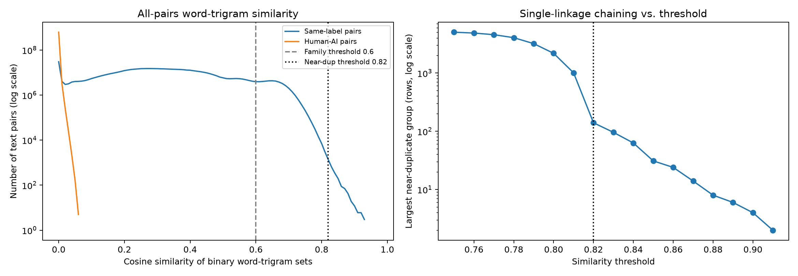
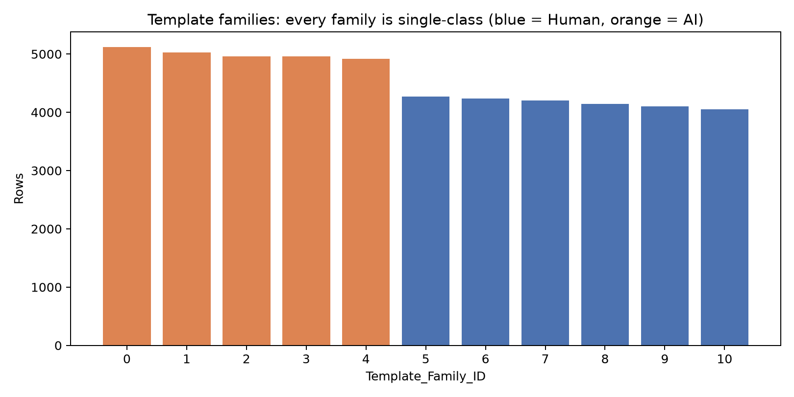

# Data Preprocessing and Exploration

## Status and decision gate

This is the redundancy and duplicate-review checkpoint. The figures and
observations below support a ping-pong review with the project owner. The owner
has approved a text-only input boundary: raw text is retained for traceability,
the benchmark detector score is evaluation-only, construction metadata is not
an input, and the unexplained/prompt-sensitive formal-tone score is excluded
from the initial input policy. The final subset of text-derived features and
the final processed CSV remain pending this checkpoint.

Because the public dataset sources do not disclose the original feature
generator, the project has chosen to independently derive a candidate feature
set from `Raw_Text` using the exact rules in `feature_derivation_spec.md` and
the implementation in `src/text_features.py`. The source columns are retained
for comparison only; they are not treated as authoritative inputs.

## Reproducibility

The raw data is loaded by `src/data_loader.py`. The existing commands are:

```powershell
python src/explore_data.py
python src/visualize_data.py
```

The visualization script writes PNGs to `reports/figures/`. It samples up to
5,000 rows per class for scatter plots with `random_state=42`; class counts and
distribution summaries use all rows. The raw CSV is not edited.

## Initial audit

The local dataset has 50,000 rows and 30 columns, with 25,000 rows in each
class. `Text_ID` and `Raw_Text` are non-missing and unique in this copy. The
required fields have no missing values. `Model_Temperature` has 25,000 missing
values, all on the Human side, which is structural missingness rather than an
ordinary random missing-value problem. `Contains_Code_Snippet` has one unique
value and is constant.

The following existing figures provide the first visual review:

- [Class balance](../reports/figures/class_balance.png)
- [Word-count distribution by class](../reports/figures/word_count_by_class.png)
- [Benchmark detector score by class](../reports/figures/detector_score_by_class.png)
- [Source model by class](../reports/figures/source_model_by_class.png)
- [Word count vs. lexical diversity](../reports/figures/scatter_word_count_vs_lexical_diversity.png)
- [Sentence length vs. readability](../reports/figures/scatter_sentence_length_vs_readability.png)
- [Formal tone vs. emotion](../reports/figures/scatter_formal_tone_vs_emotion.png)
- [Formal tone vs. burstiness](../reports/figures/scatter_formal_tone_vs_burstiness.png)
- [Coherence vs. burstiness](../reports/figures/scatter_coherence_vs_burstiness.png)
- [Emotion vs. burstiness](../reports/figures/scatter_emotion_vs_burstiness.png)
- [Formal-tone ceiling](../reports/figures/formal_tone_score_ceiling.png)
- [AI formal-tone histogram](../reports/figures/ai_formal_tone_score_histogram.png)
- [Numeric feature/target correlations (audit only)](../reports/figures/numeric_feature_target_correlations.png)
- [Missingness by class](../reports/figures/missingness_by_class.png)
- [Metadata associations by class](../reports/figures/metadata_associations_by_class.png)
- [Text-derived feature correlation matrix](../reports/figures/text_derived_feature_correlation_matrix.png)
- [Duplicate audit](../reports/figures/duplicate_audit.png)
- [Candidate text-feature correlation matrix](../reports/figures/candidate_text_feature_correlation_matrix.png)
- [Candidate text-feature distributions](../reports/figures/candidate_text_feature_distributions.png)

The formal-tone figures should be read together with
[`observations/formal_tone_score.md`](../observations/formal_tone_score.md).
They show a reproducible pattern, but the pattern's provenance is unknown; a
strong visual separation is not sufficient evidence that the field is a valid
predictor.

## Duplicate and redundancy findings

The independently derived candidate features are written to the intermediate
artifact `data/processed/text_derived_features_candidate.csv` by
`src/build_candidate_features.py`. The candidate correlation matrix is based on
these features rather than the benchmark's undocumented engineered columns.

The current exact-duplicate audit found zero duplicate `Raw_Text` rows. A second
conservative audit lowercased the text, collapsed whitespace, and trimmed the
result; it also found zero duplicate normalized texts. This reduces concern
about exact row duplication, but it does not rule out paraphrases, shared
templates, or topic leakage. A near-duplicate method using a fixed similarity
definition is still required before the final split is declared safe.

The text-derived correlation matrix shows several expected length-driven
relationships. In the local data, examples include:

- `Word_Count` with `Character_Count_Total`: `r = 0.996`
- `Word_Count` with `Sentence_Count`: `r = 0.994`
- `Word_Count` with `Punctuation_Count`: `r = 0.988`
- `Word_Count` with `Capital_Letter_Count`: `r = 0.997`
- `Word_Count` with `Lexical_Diversity_Score`: `r = -0.846`

These values identify redundancy candidates, not automatic deletions. The
approved reduced policy keeps `Text_Word_Count`, `Text_Average_Word_Length`,
`Text_Average_Sentence_Length_Words`, `Text_Guiraud_Root_TTR`,
`Text_Punctuation_Density`, `Text_Flesch_Kincaid_Grade_Level`, and
`Text_Burstiness`. It removes redundant raw counts, ordinary type-token ratio,
constant special-character count, and average syllables per word. The full
candidate matrix will still be compared with the reduced matrix using grouped
cross-validation; if performance is similar, the simpler policy is preferred.

The reduced artifact is generated and validated by
`src/prepare_final_data.py`.

## Candidate feature-policy table

| Field/group | What the audit suggests | Candidate treatment to review | Decision |
| --- | --- | --- | --- |
| `Label` | Binary target | Keep as target only; never use as an input | Approved |
| `Text_ID` | Unique identifier | Retain only for traceability; exclude from model matrix | Approved |
| `Raw_Text` | Input text and traceability object | Retain in processed CSV; derive model inputs from it; do not use the raw string as a tabular numeric input | Approved |
| Text-length/lexical/readability features | Numeric measurements of text | Review correlation matrix and combine/remove redundant features only with documented reasoning | Pending redundancy review |
| Tone/style features | Some are prompt-sensitive or provenance-unclear | Exclude `Formal_Tone_Score` initially; review remaining text-derived measures against the feature specification | Partially approved |
| Source and generation metadata | Strong construction/source associations | Exclude from model input | Approved |
| `Model_Temperature` | Missingness is perfectly class-associated | Exclude from model input | Approved |
| `Detection_Score_Benchmark_Model_A` | Existing detector output | Use only as a held-out evaluation reference, never as an input | Approved |
| `Contains_Code_Snippet` | Constant in local data | Exclude from model input | Approved |

## Proper modeling tactics to apply after approval

1. Check exact and near-duplicate text before splitting. If meaningful groups
   exist, use a group-aware split or explain why a stratified random split is
   adequate.
2. Use a stratified, reproducible train/test split. Do not inspect the test set
   to choose features or preprocessing thresholds.
3. Fit imputers, encoders, scalers, and any feature-selection procedure on the
   training data only, preferably through a scikit-learn `Pipeline` or
   `ColumnTransformer`.
4. Keep a baseline policy and at least one restricted policy if the owner wants
   to test the effect of metadata/artifact fields. Compare policies under the
   same split and metrics.
5. Use suitable classification metrics such as accuracy, precision, recall,
   F1, ROC-AUC, and confusion matrices, with an explanation of the chosen
   emphasis. Do not let preprocessing decisions be justified only by accuracy.
6. Validate the final CSV: expected columns, row count, target values, missing
   values, duplicate policy, data types, and a recorded source/configuration.

## Near-duplicate grouping and group-aware split

Implemented in `src/build_splits.py`. It writes
`data/processed/human_ai_text_splits.csv` (keyed by `Text_ID`) and
`reports/metrics/split_summary.json`. The approved seven-feature schema in
`human_ai_text_processed.csv` is unchanged; split assignments live in a
separate file and are joined at modeling time.

### Similarity definition

Each text is reduced to the set of its lowercased word trigrams `T(x)`
(212,844 distinct trigrams in the corpus). Two texts are compared with

`sim(a, b) = |T(a) ∩ T(b)| / sqrt(|T(a)| · |T(b)|)`

the cosine similarity of binary trigram indicator vectors. All 1.25 billion
text pairs are scored exactly (chunked sparse matrix products, about two
minutes on a laptop); no approximate hashing is used.

### Finding: the benchmark is template-generated

The all-pairs analysis shows the corpus has a much stronger structure than
"near-duplicates":

- Every text's single most similar other text has similarity of at least
  0.585, and in 100% of cases that nearest neighbor has the same label.
- The highest similarity between any Human text and any AI text is 0.06. The
  two classes share essentially no three-word phrases.
- Connected components of the graph with edges at `sim >= 0.60` produce
  exactly **11 template families** (plus 6 heavily word-scrambled Human texts
  that were attached to the family of their nearest neighbor). Six families are
  entirely Human (4,052–4,266 rows each), five are entirely AI (4,921–5,121
  rows each). No family mixes labels.
- Each family is one fill-in-the-blank template ("When it comes to *{topic}*,
  there are several schools of thought…") with a topic substituted and random
  word swaps/insertions applied. The AI families do not align with
  `Generation_Prompt_Type`: every AI family contains all ten AI prompt types
  in roughly equal proportion.





This means a model that sees any part of a template family during training will
be evaluated on new fills of templates it already knows. That is the main
limitation of this benchmark and it is reported alongside every result. It is
also why the raw-text n-gram vectorizers would be trivially perfect here and are
not used as model inputs.

### Near-duplicate threshold (0.82), derived from the data

Within a template family, two random texts share a lot of phrasing just
because they come from the same template. A near-duplicate must be *more*
similar than template-sharing alone explains. Two data-derived criteria were
used:

1. **Within-family background distribution.** Exact quantiles over all
   within-family pairs: median 0.571, 99th percentile 0.733, 99.9th 0.770,
   99.99th **0.801**. The threshold must sit above the 99.99th percentile.
2. **Single-linkage chaining.** Grouping is transitive, so a threshold that is
   too low chains whole families together. The largest group is 2,184 rows at
   0.80 and 1,011 at 0.81, then collapses to **140 at 0.82** (96 at 0.83,
   31 at 0.85).

0.82 is the lowest grid threshold (0.01 steps) that satisfies both. At 0.82
there are 47,779 near-duplicate groups; 3,027 rows sit in multi-text groups;
the largest group has 140 rows; no group mixes labels.

### Train/test and cross-validation split

| Step | Method | Rows before | Rows after |
| --- | --- | --- | --- |
| Test hold-out | One fold of `StratifiedGroupKFold(n_splits=5, shuffle=True, random_state=478)` on `NearDup_Group_ID` | 50,000 | train 40,000 / test 10,000 |
| CV folds | `StratifiedGroupKFold(n_splits=5, shuffle=True, random_state=478)` on the training partition only | 40,000 | 5 × 8,000 |

| Partition | Human | AI | AI proportion |
| --- | --- | --- | --- |
| Train | 20,000 | 20,000 | 0.50 |
| Test | 5,000 | 5,000 | 0.50 |
| Each CV fold (0–4) | 4,000 | 4,000 | 0.50 |

`build_splits.py` validates that no near-duplicate group crosses the
train/test boundary or a CV fold, that every training row has a fold, and that
test rows have `CV_Fold = -1`. No rows are removed by this step.

### Template-family hold-out (stress test)

Because near-duplicate grouping does not stop the same templates from
appearing on both sides of the split, models are also scored with a second set
of folds that holds out whole template families
(`StratifiedGroupKFold(n_splits=5)` on `Template_Family_ID`, training
partition only; each fold holds out one AI family and one or two Human
families). This answers a different question: does the model generalize to a
writing template it has never seen? The test partition is not used for this
experiment. **Proposed for owner review:** whether the template-family
hold-out should become the primary evaluation instead of a stress test.

### Split-file schema

| Column | Meaning |
| --- | --- |
| `Text_ID` | Join key to `human_ai_text_processed.csv` |
| `Label`, `Label_Name` | Copied for convenience and validation |
| `NearDup_Group_ID` | Near-duplicate group at `sim >= 0.82` (0 = largest group) |
| `NearDup_Group_Size` | Number of texts in that group |
| `Template_Family_ID` | Template family at `sim >= 0.60` (0–4 AI, 5–10 Human) |
| `Nearest_Neighbor_Similarity` | Similarity to the most similar other text |
| `Split` | `train` or `test` |
| `CV_Fold` | 0–4 for training rows, -1 for test rows |
