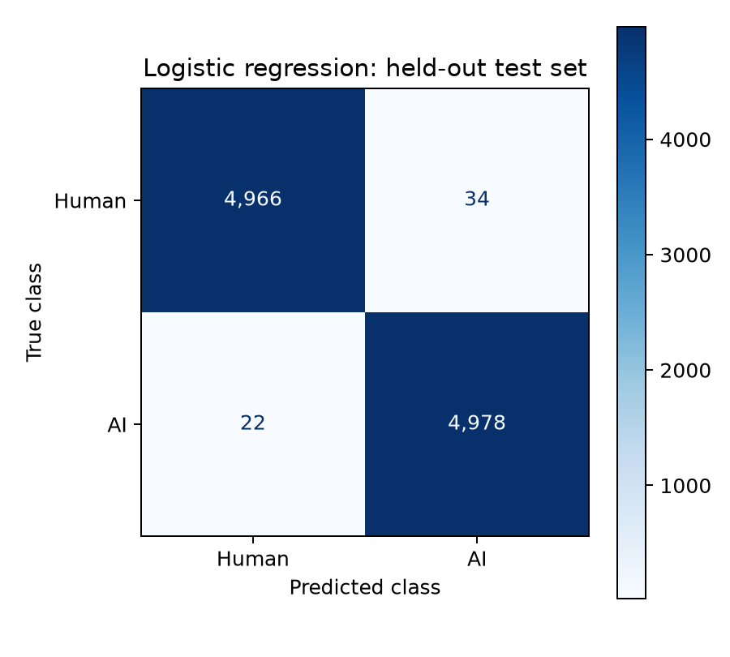
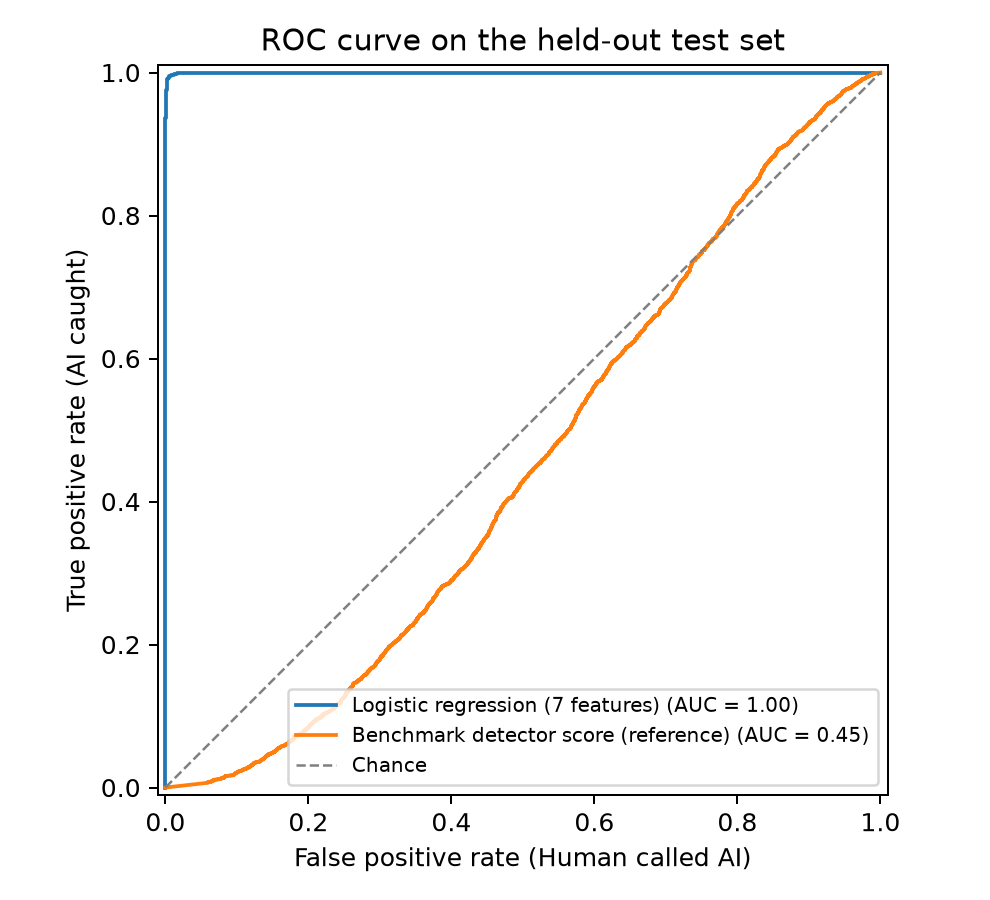
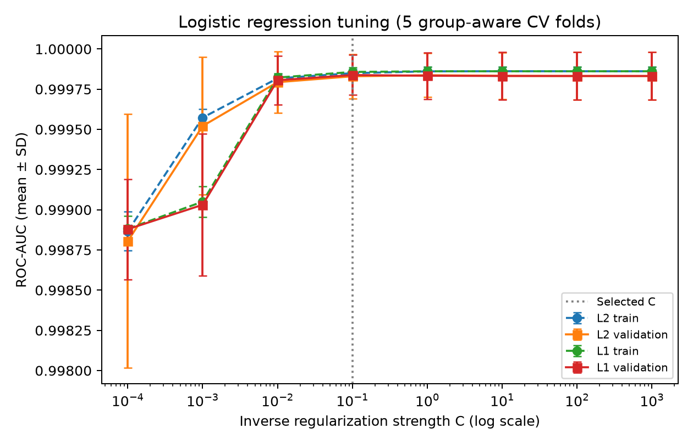
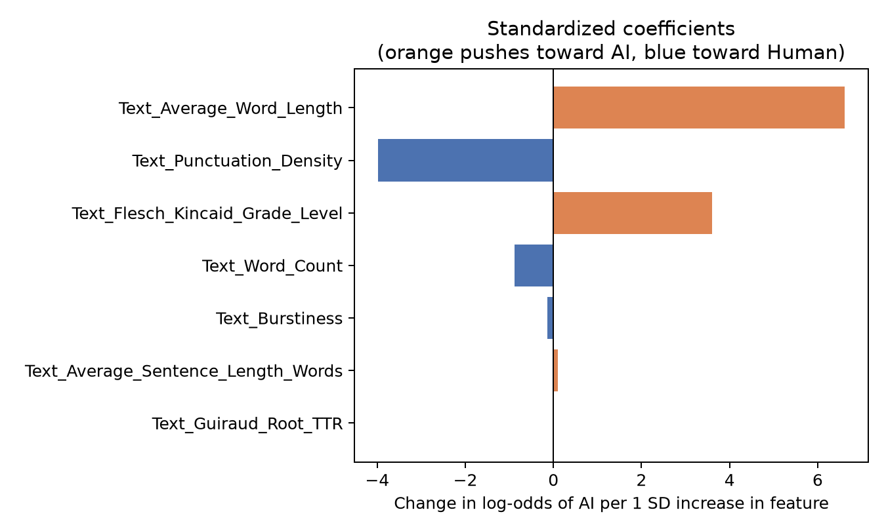

# Model Evaluation and Comparison

## Evaluation framework (shared by every model)

All models are evaluated with the helpers in `src/modeling.py`, so every
model uses the same inputs and folds:

- **Inputs:** the seven approved text-derived features only.
- **Split:** the near-duplicate-group-aware 40,000 / 10,000 train/test split
  and the five group-aware CV folds stored in
  `data/processed/human_ai_text_splits.csv` (see
  `data_preprocessing_and_exploration.md`).
- **Tuning:** on the training partition only, using the stored CV folds. The
  test partition is scored once, after the final configuration is chosen.
- **Stress test:** template-family hold-out CV on the training partition,
  where each validation fold contains whole writing templates the model never
  saw.
- **Reference:** the benchmark's `Detection_Score_Benchmark_Model_A`, scored
  on the same test rows. It is never a model input.

### Why these metrics

Positive class = AI (`Label = 1`).

| Metric | Why it is reported |
| --- | --- |
| Accuracy | Classes are exactly balanced (50/50 in every partition), so accuracy is not inflated by a majority class |
| Precision | Of texts flagged as AI, how many really are AI. A false accusation of AI use against a human writer is costly |
| Recall | Of AI texts, how many are caught |
| F1 | Single summary of the precision/recall balance |
| ROC-AUC | Threshold-free ranking quality; matters because the planned "API" returns a probability, not only a label |
| Confusion matrix | Shows which kind of error dominates |
| Train vs. validation gap | Over- or underfitting check required by the rubric |

## Model 1: Logistic regression

Script: `src/train_logistic_regression.py`. Selected configuration: L1 penalty,
`C = 0.1` (tuning details in `model_development.md`).

### Results

| Evaluation | Accuracy | Precision | Recall | F1 | ROC-AUC |
| --- | --- | --- | --- | --- | --- |
| CV train (mean ± SD, 5 folds) | 0.9953 ± 0.0002 | 0.9955 ± 0.0002 | 0.9952 ± 0.0003 | 0.9953 ± 0.0002 | 0.9999 ± 0.0000 |
| CV validation (mean ± SD, 5 folds) | 0.9951 ± 0.0009 | 0.9951 ± 0.0018 | 0.9951 ± 0.0016 | 0.9951 ± 0.0009 | 0.9998 ± 0.0001 |
| Full training partition (40,000) | 0.9953 | 0.9954 | 0.9952 | 0.9953 | 0.9999 |
| **Held-out test (10,000)** | **0.9944** | **0.9932** | **0.9956** | **0.9944** | **0.9998** |
| Template-family hold-out validation (mean ± SD) | 0.9888 ± 0.0154 | 0.9908 ± 0.0151 | 0.9836 ± 0.0345 | 0.9869 ± 0.0198 | 0.9984 ± 0.0029 |
| Benchmark detector score, test (reference only, threshold 50) | 0.4870 | 0.4902 | 0.6472 | 0.5578 | 0.4480 |

Test confusion matrix (rows = true class, columns = predicted class):

| | Predicted Human | Predicted AI |
| --- | --- | --- |
| True Human | 4,966 | 34 |
| True AI | 22 | 4,978 |

### Over- or underfitting

There is no evidence of overfitting. CV train accuracy (0.9953) and validation
accuracy (0.9951) differ by 0.0002, and the test score (0.9944) is within
about one validation standard deviation. The tuning curve shows train and
validation ROC-AUC overlapping at every `C`. Only the strongest regularization
(`C <= 1e-3`) loses a little performance, which is mild underfitting. A model
with seven features and eight parameters has little capacity to memorize
40,000 rows.

### Interpretation

Standardized coefficients (change in log-odds of AI per one standard deviation):

| Feature | Coefficient | Reading |
| --- | --- | --- |
| `Text_Average_Word_Length` | +6.62 | Longer words → AI |
| `Text_Flesch_Kincaid_Grade_Level` | +3.60 | Harder-to-read text → AI |
| `Text_Average_Sentence_Length_Words` | +0.10 | Negligible |
| `Text_Guiraud_Root_TTR` | 0.00 | Dropped by L1 |
| `Text_Burstiness` | −0.14 | Slightly more uniform sentence lengths → AI |
| `Text_Word_Count` | −0.88 | Longer texts → slightly more Human |
| `Text_Punctuation_Density` | −3.99 | More punctuation per character → Human |

The AI templates in this benchmark use formal, polysyllabic vocabulary
("contemporary discourse", "stakeholders", "multifaceted"), while the Human
templates are conversational ("Let me tell you about…"). Word length and
readability capture that difference almost completely, so a linear model is
enough to separate the classes.

### Error analysis (initial)

- On the main test split, errors are rare (56 / 10,000) and roughly balanced:
  34 Human texts were called AI and 22 AI texts were called Human.
- The template-family hold-out is the more informative result. Four of five
  folds score 0.98–1.00 accuracy. The fold that holds out AI family 0
  (argumentative template, "*{Topic}* is often discussed in terms of its
  immediate impact…") together with Human families 9 and 10 drops to
  **0.965 accuracy and 0.922 AI recall**. An AI template the model has never
  seen is the realistic failure mode, and it is concentrated in one template.
- The benchmark's own detector score is worse than chance on these rows
  (ROC-AUC 0.448). That supports the earlier decision not to trust it as a
  feature, and makes it a weak external reference.

### Caveat for every result in this file

Near-perfect scores here mean the benchmark's 11 generator templates are
separable by simple style statistics. They do not show that real human versus
real LLM writing can be separated this well. Even the template-family hold-out
only tests generalization across 5 AI and 6 Human templates from one
synthetic generator.

## Models 2–5

Pending. Each should reuse `src/modeling.py` (`load_model_data`,
`predefined_cv`, `template_family_cv`, `classification_metrics`) and add a row
to a combined comparison table here.
